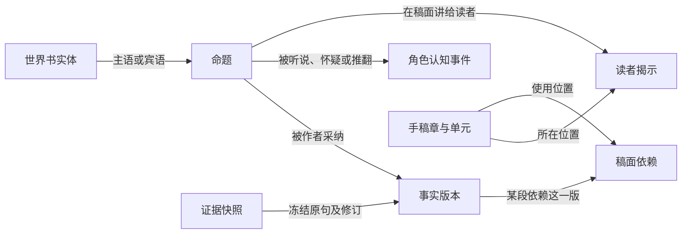

# 小说世界模型数据库设计

作者的《面向小说的世界模型数据库设计方案》把实体、关系、时间与知情分开。以下以临川北门的故事说明设计，区分已在 Pinax 中运行的部分和后续目标。[时序与知情实施计划](../plan/nightly-20260917-memory-continuation.md) · [既有事实账本](./memory-fact-ledger.md)

## 已接入的部分

Web 在现有事实账本的 Dexie 第六版增加 `worldClaims`、`disclosures`、`claimUses`。书级作用域沿用原有账本。旧事实和获知事件补齐命题引用，保留原事实链、证据及记录序号。当前浏览器库为 Dexie 第十二版，工作区 ZIP 的账本域为第二十四版。旧记录共用一个事件身份时，系统无法从旧版本推断到底发生了几次。Dexie 第七版给人物认知更正建立唯一前序索引。第八版另索引事件发生地和明确的对象引用。第九版增加稿面修订和章节修订，以及按事件命题反查稿面的索引。第十版支持按命题追溯人物的获知原文。第十一版补充作品历法修订索引。第十二版索引作品的试写分支。ZIP 账本域第二十四版可读取第二至二十三版，并检查认知更正链及事件地点、参与者与名称之间的引用。小说项目的 SQLite 目录继续承担文件检索。

已登记的传闻可以按其命题 ID 确认为事实。确认记录带独立的记录序号，事件采用传闻原有的发生身份。人物信念和读者引述各自沿用原账本中的记录。

- 正式事实和传闻可以指向同一命题。关系按对象区分，重复事件按每次发生区分。正式登记和常规提案采纳共用事务、证据和决定。作者可在直接登记或证实传闻时选择章段作证，地图能按单元身份和内容指纹回到这段依据。采纳试写事件会把有关联的章段证据带回正史。人物获知和稿面揭示仍需各自登记。事件可另行登记多个发生地，以及交付人、收件人等具名角色。更正地点或参与者后保留同一次发生的身份，由新的命题表示修订后的说法。地图按作品、地点实体及最新正式版本查询；旧角色消息继续保留最初听到的地点和参与者。
- 作者可以按作品历法、纪元、整数故事时点和记录序号查正式事实。留空故事时点时，已被后继状态取代的历史区间只在指定故事时点的查询中出现。角色按自己的获知与态度记录回放，同一天按记录顺序区分先后。旧版只引用正式事实的获知记录保留旧语义。新命题的获知和态度分两次登记，历史列表保留各次获知渠道。误登的经历可单条撤下。如果撤下会让后来的态度失去获知依据，作者须先核对那条态度。当前视角、地图来源及用稿依据一起更新；旧记录截面仍保留原经历。更正登记时追加新行，保留旧记录截面以及同一故事日的原始事件次序。
- AI 同伴读取本场人物知识时，若同时查到多人，必须指定其中一人；只有一个结果时才可直接使用。上下文保留首次获知方式、最近获知方式及转述者，排除作者修订标记、未来获知计数和已遗忘内容。
- 人物心理推演根据所选人物与场景序号冻结其可见说法，连同光标前正文和当前场景发送。已推翻的消息带人物自己的判断，已遗忘的消息不进入推演。若遗忘或态度变化尚无日期，指定日期的视角暂缓引用该条，并向作者提示。故事序号缺失时只使用稿面与现场。推演前后与采纳时重读可见资料修订，登记或更正已知说法会使过期结果失效。
- 读者视角以当前稿面读完一个单元为界，显示之前登记的叙述断言和人物引述。具名引述保留说话人的条目标识与当时姓名，改署名会留下可回看的记录。新登记冻结原句、单元身份、原句哈希和截至该段的章段顺序。在后面追加章节或叙述单元，前文的揭示和设定依赖仍有效。本次登记的稿面修订共享未改章节，保存各章标题、单元顺序和文字指纹。作者可按登记时的稿面和记录序号回看。删去后文时，若登记稿次证明读者仍在它之前，前文照常显示。旧登记保存全书顺序指纹，仍按原指纹核对。误登的揭示可按说话人与原句单独撤下，旧记录截面仍能回看。改稿后作者可在原句和新段落之间重新定位揭示，保留署名与原有说法。旧稿次可配合记录序号回看原揭示位置。锚点失效也可复核或撤下。
- 作者可以先预览更正一条正式事实会波及哪些已登记的用稿段落，查到各章和原句。更正后，原本依赖旧版本的段落显示待复核，人物出于误信采取的行动可照常保留。复核时可指定新版本。
- 当前的事实文字、实体对象和作品历法覆盖工作台已有入口。数值可带单位，布尔值区分是和否。两种字面量都参与命题身份、稿面引用和人物获知。否定陈述可以独立获得证据，若与同一时点成立的相反事实相遇，作者可看到提示。试写分支可继承正史指定记录截面的事实、证据和历法。作者可以为还没有分支经历的人物继承截至分叉点的有效认知，包括更正后的讲述人、经历顺序、态度与原文证据。嵌套分叉与任意时刻整本原文回放仍为设计目标。作者可在场景锚点同时保存日期原文、作品历法、纪元和整数序号。稿面查询使用本段有效锚点的视角人物和序号；仅有日期原文的旧场景仍由作者选择时点。地图先区分时间线和纪元，再在同一组内比较序号。

世界书条目的上下文面板可以按本章末段的时点核对本书正史。用条目身份匹配正反向关系、发生地与具名事件角色，另外列出该人物当时登记的见闻与态度。取消日期筛选后，人物见闻仍沿用本章历法。作者可沿关系端点打开对应条目，并从正式事实核对全稿出处。历史状态保留自己的依据，后任与前任的原句按命题区分。地图地点支持同时指定故事时点和记录截面，按所选纪元筛选，并把日期未定或不可比较的事件单独计数。

[工作台使用说明](../user-manual/07-settings.md) · [生产路径浏览器验收](../../scripts/novel-world-model-integration-smoke.mjs)

## 两个可借鉴的研究思路

World Labs 将一个持久的空间表示用于查看、编辑和模拟。从这个思路出发，Pinax 让作者、人物、读者和地图引用同一命题，再根据各自能看到的记录回答问题。同一句“北门已封”可以同时出现在传闻和台词里，作者只需确认它的来源与身份。[World Labs，3D as code](https://worldlabs.ai/blog/3d-as-code)

Google DeepMind 用 Genie 2 展示从同一初始画面采取不同动作的后果。小说数据库中可验证的对应操作，是从一版已确认的设定出发，先查改动会影响哪些已登记段落，再由作者决定是否更正。这项预览读取确切的版本依赖，不生成替代剧情。[Google DeepMind，Genie 2](https://deepmind.google/blog/genie-2-a-large-scale-foundation-world-model/)

## 一部小说要能怎样查

下面的北门和结盟情节是为原案人物编写的验收样例。临川北门实际开放。故事第 3 日，林昭听信封门的消息，因而绕路。同来的信使也听到了，尚未表态。第 7 日，林昭到城门口亲眼核实，推翻了原先的判断。作者在第八章用插叙描写林昭的第五日。

| 创作问题 | 预期回答 |
| --- | --- |
| 故事第 5 日，临川北门能通行吗？ | 作者视角返回当日有效的“开放”和所据的正文或作者断言。 |
| 写第八章这段插叙，林昭会怎么选路？ | 按初稿，第 5 日他仍然相信北门已封。若作者后来补写“第五日已起疑”，按新稿回看则是存疑。两种写法中的林昭都尚未经历第 7 日的核实。 |
| 同场的书院弟子也知道封门的传闻吗？ | 缺少弟子获知这条说法的记录，回答“未记录”。仅凭出场名单无法判定他听见、相信或反对。 |
| 读者在读到这段插叙时知道什么？ | 取决于北门消息在手稿中何处揭示。若第六章已明说门开，读者可以知道林昭误判，仍能写出一个相信门已关闭的林昭。 |
| 林昭同时与白鹿书院、临川守军结盟，可以只解除其中一次盟约吗？ | 两个对象各自保有盟约。解除与守军的盟约只关闭该段关系的故事区间，过去的盟约和与书院的关系均可查。 |

接入前的 Core 0.16 实测出了三个差异。逐条引用原文并采用“林昭与乙结盟”“林昭与丙结盟”后，正式事实只剩丙。第 1 年听说、第 10 年遗忘的角色，查询第 2 年也会被列为已遗忘。作者后来更正事实后，在同一个旧记录截面重查，角色视图还会提前出现“已被更正”的标记。这三项分别约束下文的事实身份、认知回放和记录时间截面。[事实命令入口](../../src/services/memory/ledger/factLedger.js) · [认知命令与查询入口](../../src/services/memory/ledger/knowledgeLedger.js)

## 完整设计中的实体、事件与证据

下表保留原案希望表达的全部字段。已交付的子集见上文和生产路径验收。当前事件可登记多个地点与参与者角色，角色在听到消息时保留当时说法。

| 记录 | 身份与基数 | 唯一写入方和含义 |
| --- | --- | --- |
| 世界书条目 | 正式实体用 `(worldbookId, entryId)`。一个实体可以有多个称呼，同名可以命中多个实体 | 世界书管理人物、地点、组织、物品、事件条目的名称、别名和设定正文。风格、禁忌、资料等条目继续服务创作，进入角色视角需有范围与获知依据。 |
| 场景和手稿位置 | `(bookId, chapterId, unitId)` 定位叙述单元，`anchorId` 标识已确认的场景锚点。揭示和用稿另记章序指纹、内容修订及必要的原句范围。同一事件可在几个章节被讲述 | 手稿保存场景、出场人和地点引用。地图对象通过已确认的地点绑定解析到同一个世界书条目。字面提及、同场和模型推测可提供定位线索。 |
| 命题（`worldClaims`） | 不可变 `id`，归属 `scopeKey`。保存 `subjectRef, predicate, objectRef` 或有类型的 `literal`，二种宾语恰取其一。否定有明确 `polarity`，事件类可带 `occurrenceId` | 账本管理“某件事的具体说法”。同一命题可有零到多条采纳版本，也可以只被人传述。一次辟谣保留当初听到的原话和命题。 |
| 正式事实（`factVersions`） | `id, scopeKey, factKey, claimId, validInterval, recordedSeq, invalidatedSeq?, supersedes?, evidenceIds[]`。一个版本引用一条命题，一条事实链可以有多个版本 | 作者采纳、更正、撤回沿用账本事务。来源取自原有 `evidenceSnapshots`，保留来源、修订和原句。AI 提案留在 `factProposals`，作者决定保存在 `factDecisions`。 |
| 角色认知（`knowledgeEvents`） | `id, scopeKey, actorKey, claimId, factVersionId?, kind, belief?, channel, storyAt, recordedSeq, sourceRef, supersedesEventId?`。多个角色可对同一命题有相反态度 | 账本追加获知和态度变化。听谁说、在哪一场、引用哪句话分别用有类型的出处表达。引用正式版本时同时校验其命题和范围。听到传闻可以只引用命题。 |
| 读者揭示（`disclosures`） | 每条含 `id, scopeKey, claimId, disclosureKind, speakerRef?, manuscriptAnchor, evidenceIds[], recordedSeq, invalidatedSeq?`。同一命题允许不同位置揭示 | 由账本登记经作者确认的揭示。角色台词能让读者听到传闻，叙述者可以明确断言真相，`disclosureKind` 保存二者的区别。缺少登记时只能答“没有查到已确认的揭示”。 |
| 稿面对设定的依赖（`claimUses`） | `id, scopeKey, consumerRef, claimId, expectedVersionId?, useKind, storyAt?, recordedSeq, invalidatedSeq?`。一段正文可以依赖多条设定，一条设定也可以影响多段 | 账本持有作者确认的依赖。消费者引用到具体稿本与章、单元或素材。`useKind` 区分叙述断言、人物信念和创作约束。自动提取的可能关联先供审阅。 |

实体与命题之间用正式引用连接。下图的每条箭头表示一段数据依赖，箭头标签说明在何处能找到这条引用。

实体引用始终携带命名空间和原始 ID，大小写与标点原样保留。改称呼能沿原 ID 找回关系、参与事件及场景。未绑定的地图点、同名的两位林昭及旧稿里的裸字符串保留为待消歧引用。作者可以确认或撤销一条映射，原证据仍保留当时的称呼。两个作品即使共用白鹿书院的条目，各自的盟约和知情史仍归各自作品。[现有实体解析](../../src/services/project/knowledgeReadModel/identity.js) · [正式场景与地图地点](../../src/services/worldbook/settingContextModel.js)

## 哪些记录算同一件事

旧版 `factKey` 按主语和谓词派生。新记录中，`claimId` 标识说法的内容，`factKey` 标识作者可独立修订的一段事实，`factVersionId` 标识这段事实某一版。两句同文、两个同名人物或两次相似行动都可以有不同身份。

| 谓词种类 | 同一事实如何识别 | 写入示例 |
| --- | --- | --- |
| 已声明单值的状态 | 同范围、主体、谓词和限定条件组成状态槽。一次连续有效的状态占一段，拥有独立 `factKey`。仅在故事区间重叠且值互斥时产生冲突 | “正印持有人”可以先是林昭、后是弟子。第 8 日交印产生新的一段，并关闭旧段。作者发现第 3 日就写错了姓名，则沿旧段更正，保留旧稿截面。 |
| 可并存的关系 | 关系类型、两个有方向的实体端点及必要的角色限定共同确定关系，同一关系的多次存续可分别建段 | “林昭隶属书院”“林昭欠书院钱”是不同关系，“林昭与两家结盟”也是两条。只有登记为对称的谓词才规范端点顺序。退盟后再入盟可以有两个有效区间。 |
| 可重复事件 | 每次发生有独立 `occurrenceId`。事件类型、角色化参与者、地点、故事时间与证据属于发生记录的版本 | 林昭两次拜访书院，即使参与者、地点和台词相同，仍是两次。第二卷重述第一次拜访，只增加叙述锚点。已有事件条目可被明确绑定为该次发生的身份。 |
| 未登记的自由谓词 | 默认允许多项并存，保留原文和候选来源。作者可以给谓词声明单值、方向、取值类型等约束 | “师从”可以有多位老师。采用第二条时直接复核其端点和区间，不能据词面猜定唯一师父。 |

谓词约束在初版由 Core 随版本提供。每个正式版本附上采用时的 `predicatePolicyVersion`、基数、方向及 `qualifiers`，避免词义变更后按新规则重解释旧稿。持久标识用独立 ID，等价或冲突判断用有类型的字段组合。关系事实的版本可带既有 `stance/covert/weight/src`。立场须有方向或主体，权重沿用原义，暗线用于作者控制展示。亲疏、证据强弱和是否知情是三个不同字段的职责。

同一次发生的正式版本另带 `event = { occurrenceId, eventType, participants[], placeRefs[], occurredAt | occurredDuring }`，点时间和区间恰取一种，未知可显式标注。参与者行用 `(role, entityRef)` 表达交付人、收件人或目击人等角色。作者采纳事件时，由账本在同一事务内写入发生身份、命题引用、事件载荷和证据。更正发生地点沿用原 `occurrenceId` 新建版本。地图按该版本的地点生成反查。确认“他在场”与确认“他看见了哪个细节”可以引用不同原句。

世界书里的静态声明仍由条目编辑器写。作者把一条关系登记成有历史的事实时，账本保存原条目、关系及来源修订。关系图可合并展示对应的声明和账本段，并标明来源。之后的条目编辑触发复核。不能从图中共现次数重建已解除的盟约，也不能用反向写回把旧时间段抹平。[世界书既有关系约定](../plan/worldbook-unification-abc-20261008.md)

## 三种位置，四种查询

**故事位置**沿用有时间线与纪元的 `StoryPoint`。事实有效区间取左闭右开 `[start,end)`。作者写“自第 1 日起持续有效”，第 5 日应命中。若只知道第一天成立、终点不明，第 5 日只能答“无法判断”。状态和关系可明确登记“起点已知，结束日期不确定”，并可附最迟已经结束的纪元和序号。查询起点成立，中间日期未知，抵达最迟界限时已不成立。作者可修订持续情况，保留原先记录截面。无可比较的纪元、未知日期和不同时间线也会产生“无法判断”，第 0 日是合法时间。瞬时事件按发生点匹配。持续事件可分别登记开始与排他结束日期；跨纪元的围城可查到临近结束的某一天。更正起点保留作者登记的终点。地图同时展示两端。

**记录位置**使用范围内单调递增的 `recordedSeq`。版本须先满足 `recordedSeq ≤ R`，同时满足 `invalidatedSeq` 为空或 `R < invalidatedSeq`，才能在截面 R 读取。作者修订发生在这一轴上。故事里真的换了持印人，需要给旧段补结尾并新增新段，二者在同一决定中落账。截在决定前仍能重放旧理解。

**叙述位置**由手稿中的章、单元和必要的原文选段确定。要表达“只对第 3–7 章生效”，作者可在用稿检查将一条约束登记为含首尾段落的稿面区间，用第 3 章起点和第 7 章末尾作界，含两章全文。若指的是故事中这段时间，另行选择故事区间。换序时重算章序并核对边界。两端共用登记稿次，终段另有冻结的原句证据。端点删除、修改或顺序反转后，失效关联与设定影响预览会提示复核。章序修订指纹用于发现变化。严格回看旧稿的读者视角还要有当时的章序或手稿快照，缺失时返回无法重放。[手稿顺序与单元定位](../../src/services/writing/manuscriptPositionIndex.js)

| 查询合同 | 必须满足的条件 |
| --- | --- |
| 作者问世界在 S 时怎样，按记录 R 回看 | 先取被授权范围内 R 可见的正式版本，再判故事区间是否包含 S。返回命题、版本、作者决定和证据。只有证据存在的传闻仍不进入正式世界状态。 |
| 角色 A 在 S 时相信什么，按 R 回看 | 取同域 A 的获知与信念事件，先逐条过滤记录截面和故事时点，再按故事先后折叠。相同确定时点用决定内明确顺序或记录序号定序。重获知可重新建立认知。回填早年的消息按故事位置插入。不确定先后的互斥信息保留来源并标为存疑。 |
| 读者到手稿位置 N 已获哪些信息 | 按 R 选择揭示记录，在所请求手稿版本中比较锚点，返回已揭示的内容和叙述来源。对尚未揭示或无法定位的秘密，角色/读者输出都不提供隐藏内容、命中数或后续章节标题。 |
| 地图中点临川，第五日发生过什么 | 从绑定的地点 ID 查询已确认发生记录及其手稿锚点，另列正式场景和字面提及。若一个事件只知“在临川”却不知日期，可在作者的日期未定栏查看。 |

角色视图只展示该角色收到的说法、可见来源与态度。`channel=heard` 只说明听过，可以同时记录“未表态”。只有明确的台词、行动或作者决定能支持“相信”。因此信使可以回答“我听过封门的说法”，角色助手不能替他写成“我确信北门已封”。另一个缺少获知记录的弟子连这条传闻也看不到。被怀疑、被遗忘、被推翻均保留事件历史。写对话时，已推翻的说法可按需作为“他知道先前的传闻有误”呈现，遗忘的内容不进入其当前回忆。只有作者视图可比较客观版本，比较时两侧均须沿用同一个记录截面。

作者把“获知于第 3 日”订正为“获知于第 5 日”时，在记录轴追加指向旧事件的修订，先按 R 确认当时有效的事件集，再按 S 回放。新稿查第 4 日应为尚未听说，旧稿的第 4 日仍能读到原判断。这与林昭自己在第 7 日改变看法采用不同的命令。

**改设定后的连贯性检查。** 如果作者把“北门自第一日起关闭”更正为“北门开放”，用被取代的 `factVersionId` 反查稿面依赖，核对相关场景的故事区间。第三章叙述者明确写“北门已封”，应提示作者回到该段核对。第三章有人因听到传闻而绕路仍可能完全合理。改动只标记相应依赖的复核状态，修改正文仍由手稿编辑器完成。

## 写入、隔离与旧稿进入方式

1. **审阅与写入。** 正文摘录进入原有证据快照。候选可以指向一条已有命题或携带拟建命题。采纳事务核对来源修订、范围、实体引用和作者所见的版本，将命题、正式版本、决定及必要的区间关闭一起提交。核对产生的约束冲突可由作者选择共存、更正、结束旧区间或保留待审。同一个 `commandId` 与相同载荷重放原决定，异载荷拒绝。补记“林昭听过一句话”只写命题、认知事件和决定。它本身不需要也不产生正式世界事实。
2. **证据与删除。** 证据保存来源 ID、来源修订、原句和可用的章/单元定位。来源改写会使当前定位或依赖提案需要复核。作者已确认的历史事实保留其原证据和决定，再由作者更正或撤回。条目被移除后保留带出处的失效引用，不能把关系自动交给新建的同名人物。
3. **作用域与分支。** 复用现有 `ScopeRef`。书级是作品正史，会话分支须有 `sessionId + branchId`。作品或分支内的命题、证据、事实与认知引用必须同域，实体引用另核对绑定世界书。首批分支读取精确匹配作用域。作品试写分支显式冻结父范围与父记录截面。可见事实连同历史有效区间、证据与历法复制到子分支，子分支在自己的记录轴写入变化。人物认知可由作者按人继承分叉截面的经历；分支也可以独立登记人物认知与稿面关联。跨范围回放须按各自序号取截面。未登记分叉点、旁支新消息或共享世界书条目均不能成为隐式继承依据。分支推演进入正史时，作者逐条确认所选版本和现有用稿。采纳决定和证据指回分支版本与其记录截面。正史分叉后已变动时保留两侧记录供作者核对。
4. **物理归属。** 现有 IndexedDB 账本已在同库增加命题、揭示及稿面依赖集合，扩展事实版本及认知事件。按范围分别建立主体、事实链、角色、揭示章节与依赖版本的索引。跨表同域检查由账本命令在同一事务内执行。事件参与者反查、地图图层、文件目录及 RAG 可由已授权记录生成。原案中的联机事件记录玩家做过的操作，本机项目库记录文件及其修订。引用它们作为小说事件的证据后，正式认定仍走账本。跨载体写入沿用原方案的顺序提交和补偿策略。
5. **兼容与落地顺序。** 先在独立 Core 的写入与回放合同内支持旧行和新行，再让 Web 宿主升级 Dexie、预览和 ZIP 域版本。对旧 `factVersionId` 可按版本确定性映射到命题并保留原文、证据与旧链。旧身份已被小写化或旧多对象记录共用一条链时，保留旧读法并列入人工复核。对旧认知记录保留原 `actorKey`、数值时间、原事实版本及修订。仅在人物和纪元映射明确时生成新引用，旧行的空值不能推回为第 0 日。旧 ZIP 的同名人、数值零、未知时间和混合版本引用都需经过导入、导出、再次导入的对照验证。待往返、重启及冲突回滚通过后，再把人物详情、地图与角色写作上下文接到相应读视图。

## 设计验证

执行 `node scripts/novel-world-model-design-check.mjs` 可在独立 Chromium 和 Dexie 中重跑样例。它验证两条盟约可分别更正、同一地点可两次到访、传闻可在客观事实之外存在、回填态度后可重放旧稿，以及同书异分支各自可见的内容。读完第六章揭示单元以后，读者可在第八章看到门开的信息。林昭的第五日视角仍取决于自己的经历。揭示原句被改写、单元失踪或拿到过期稿本时，样例会返回无法定位。[可执行样例](../../scripts/novel-world-model-design-check.mjs)

设计样例使用单一纪元和整单元的阅读位置。正式入口及当前可验证的范围见本文开头。
