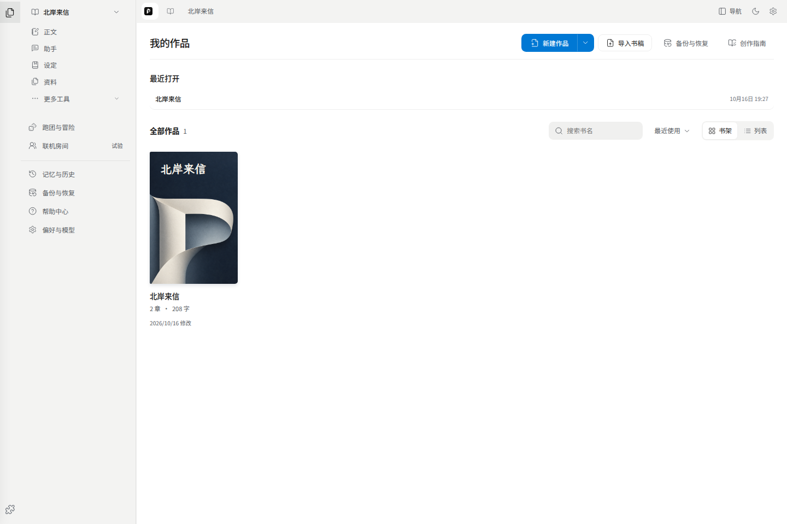

# 快速开始

## 1. 打开或创建作品

首页可以新建作品，也可以导入 TXT / Markdown 书稿。导入时先检查章节划分和预览，再确认创建。PDF、Word 和其他参考文件请从[资料导入](./03-worldbook.md#导入参考资料)，它们不会自动成为正文。

已有作品从首页最近打开或作品列表进入。最近打开按作品汇总，不会把一次助手问答或每个文件列成一项。

## 2. 认识工作区

左侧默认按 **正文、构思、设定、资料、素材、漫画** 收纳内容。设定文件夹使用关联世界书的名字，下面再按人物、地点等分类。可以新建文件夹或调整归档位置；移动章节所在文件夹不会改变书稿顺序。

右键文件夹，选择 **新建** 可在其中创建章节、构思、设定、漫画页或导入资料；**新建文件夹**会在当前文件夹中添加子文件夹。新建和重命名文件夹时直接在目录行输入，Enter 保存，Esc 取消。顶部 **＋** 也保留。

拖到行间调整目录顺序，出现横线后松开；拖到文件夹中部则移入其中，目标文件夹会高亮。键盘或触屏可用菜单里的 **移到…**。搜索或筛选时不能拖动排序，先清除筛选；人物、地点等自动分类不支持手动移动。移除文件夹会把内容移到上一级，不删除原件。

左侧活动栏用图标切换文件目录、查找、章节顺序和扩展。悬停可看名称。要调整卷和章节的顺序，切到 **章节顺序**；要整理不同类型的内容，用 **文件目录**。

桌面打开正文会展开目录；写作中可以手动收起。返回首页会保留当时的展开状态。手机通过目录入口打开抽屉，选完内容后回到编辑区。

中央标签显示已打开的内容。打开设定或资料后，再点章节标签即可继续写作；不需要先返回首页。

## 3. 写第一段

打开一章，直接输入。编辑会自动保存；底部可查看字数等信息。字体、行距和缩进可从工具栏 **排版** 调整。

看到保存失败时，先保留页面并复制未保存的文字，再按提示重试。不要通过清理浏览器数据解决保存问题。

右侧工具是按需打开的：

| 工具 | 适合什么情况 |
| --- | --- |
| 助手 | 讨论故事、查资料、要求续写或修改 |
| 推演 | 从当前正文继续写，或比较接下来可能发生的事 |
| 批注 | 给选中的文字留意见，处理校对建议 |
| 大纲、角色、设定 | 写作时对照和编辑本书内容 |

不用 AI 也能写作、整理设定、导入和导出。使用 AI 时，公网可用站点提供的服务器模型；自建环境按[模型设置](./07-settings.md#ai-配置)配置。

## 4. 添加人物或资料

从左侧新建入口选择 **设定**，填写名称和类型，即可写人物小传或地点说明。属性需要时再展开，不必先填完模板。

已有资料则选择添加文件，打开导入浮窗。文件解析后检查内容，确认加入本书。新作品还没有世界书时，会在确认创建或导入时建立关联。

## 5. 用一次助手

打开助手，输入具体要求，例如“保留这一段的事实，把对话改得更自然”。默认 **审阅修改**：助手提出的正文修改会在书稿里展示，点击采用才保存为正式正文。

只想讨论可选 **只读**；需要直接修改可选择 **自动修改**，并检查授权的章节、设定和大纲范围。详细的修改、重答和会话操作见[写作指南](./05-writing.md#助手)。

## 6. 留一份备份

正文导出便于在其他编辑器里阅读和继续写；**完整工作区 ZIP** 用于保留书稿、设定、来源归档和已保存的媒体。

换浏览器、设备、域名或从 HTTP 改用 HTTPS 前，先在原地址导出 ZIP，再到新地址恢复。具体步骤见[备份与恢复](./07-settings.md#备份与恢复)。
