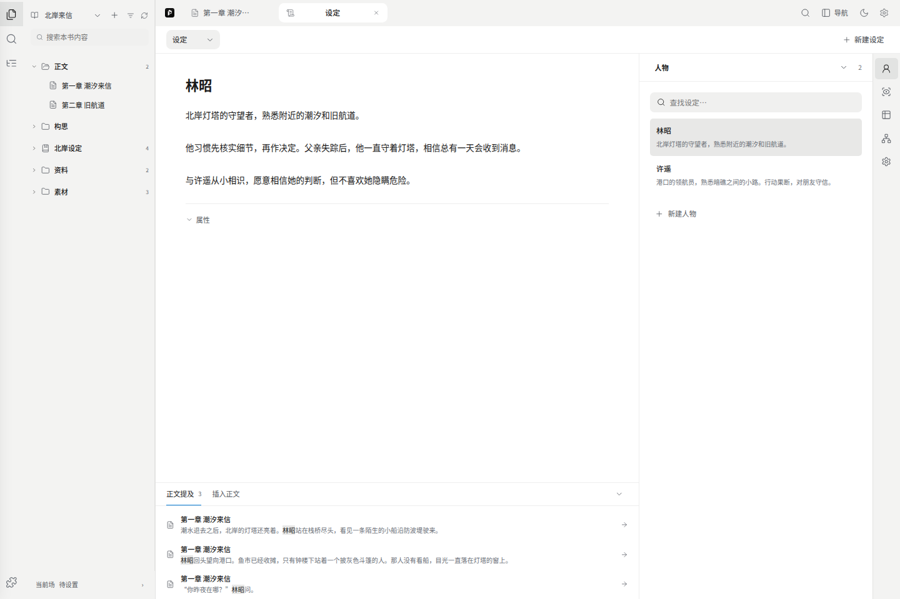
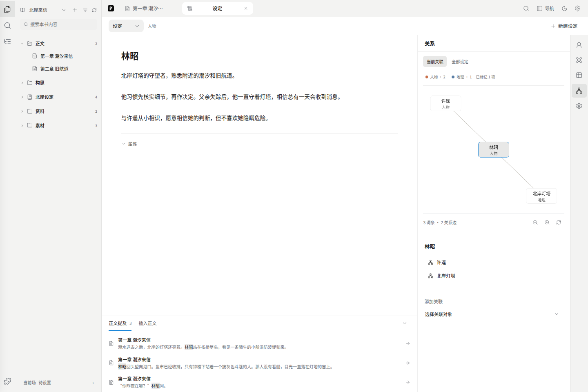
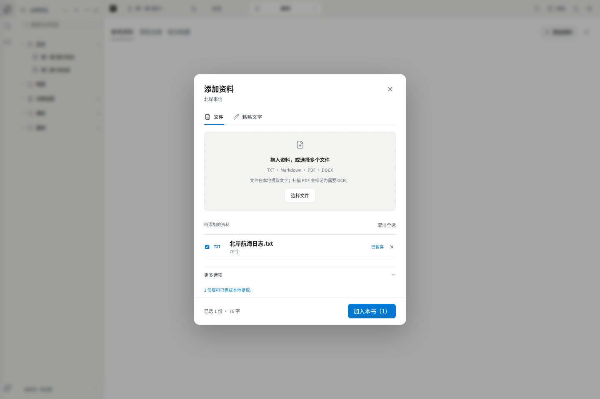
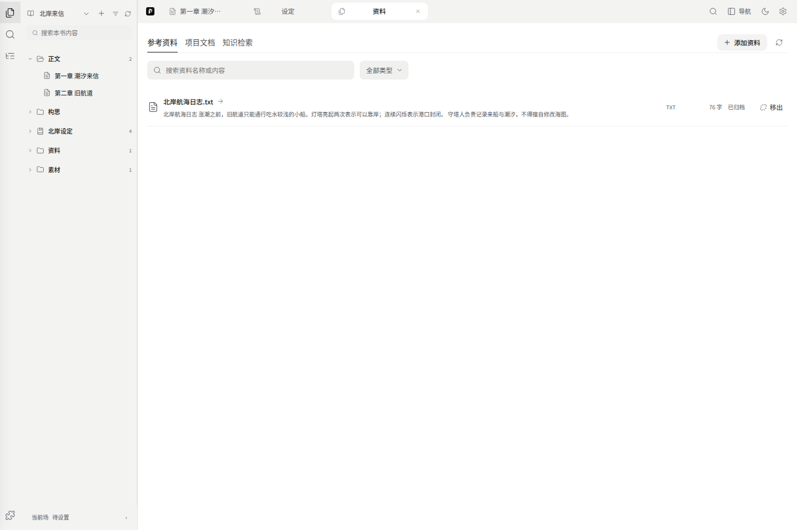

# 设定与资料

**设定**是你写下并维护的人物、地点和世界规则；**资料**是用来查阅的来源。两者可以关联，但导入一篇文章不等于把其中的说法都确定为故事事实。

## 打开本书设定

从左侧世界书文件夹打开一个人物或地点，中央就是它的标题和正文。也可以打开设定集合，再从右侧同类列表选择条目。两个入口编辑同一份内容。

作品通过关联世界书决定使用哪一组设定。切换作品会随之切换上下文；若关联发生变化，旧视图会要求重新打开，避免把修改写到另一份世界书。多部作品主动关联同一世界书时，修改的是共享设定，不是各书副本。

## 新建与编写

1. 从目录新建入口选择 **设定**，填写名称和类型。人物、地点、组织等类型用于分类。
2. 在中央直接写正文。失去焦点或切换条目时会尝试保存，也可用 Ctrl/Cmd+S。
3. 需要别名、结构字段时展开 **属性**，选择模板或添加字段。只用自由正文也可以。
4. 管理名称、类型等信息时打开右侧 **管理**，按面板提示保存。

保存失败或还有未处理的属性、表格修改时，先保存、重试或明确取消，再切换。输入会保留，不应通过刷新来丢弃错误。

### 属性和正文不一致时

结构字段可以生成正文描述，但你也可能手改过正文。出现差异时，选择只保存字段、保留原正文，或明确用字段结果覆盖正文。不要把“保存属性”理解成所有地方都会无条件同步。

旧版的世界观、故事核心等集中字段仍在 **创作基调**；它是可选内容，不再是新建人物前必须完成的表单。伏笔也有单独入口。

在创作基调里用 AI 补全一节后，草稿会列在“待审草稿”。可以打开每项修改后采纳，也可以点“全部采纳”一次写入本节草稿。世界书在生成后发生变化时，先核对新内容再重新生成；失败时草稿仍保留。地点目录的“从概述整理”按地点逐项确认。

## 右侧工具

图标悬停时显示名称，点击打开对应面板：

| 面板 | 用途 |
| --- | --- |
| 同类设定 | 按人物、地点等分类查找，切换正在编辑的条目 |
| 场景与经历 | 查看已有场景记录中的出现位置、地点和相关经历 |
| 表格 | 按行整理条目和字段；需要更宽的空间可放大表格 |
| 关系 | 默认看当前条目及直接关联，可切换全部设定；点击节点打开对象 |
| 管理 | 调整当前条目的管理信息；修改与中央正文共用原件 |

关系图留在右侧，中央仍可读写正文。图上出现连线不代表系统已经判断了全部人物关系，关系内容要以实际记录为准。

**场景与经历**读取已有的正文场景锚点和世界书历史。正文中只提到某个人名，不会自动认定这个人已到场，也不会据此猜测当前位置。地点有地图定位时可打开已有地图；没有绑定时不能凭空定位。

## 底栏：正文提及与插入

- **正文提及**按名称和别名查找本书章节，点击结果回到对应段落。同名结果会标明，仍需核对是否指同一个人物。
- **插入正文**把当前设定的名称插到已打开章节的光标位置，选区存在时插在选区末尾，不覆盖选中文字。面板会显示目标章节；可在正文撤销。
- 底栏可以收起，也可以拖动上边缘调整高度。

名称匹配不是事实提取；插入名称也不会复制整篇设定或替你更新人物经历。

## 导入参考资料

从本书资料入口选择添加文件，会打开导入浮窗：

1. 选择或拖入文件，也可以粘贴文字。拖到浮窗上会显示放置提示。
2. 等解析完成，检查标题、内容和失败项。
3. 确认加入本书。可继续添加，不必每份文件重开页面。
4. 从资料列表打开来源，查阅内容；需要提取设定时再发起提取并审阅结果。

支持 TXT、Markdown、DOCX、PDF。当前单个 PDF 上限 100 MB，其他文件上限 50 MB；这是导入限制，不是模型能一次读完的篇幅。扫描 PDF 如果没有可提取的文字，需要先 OCR。解析失败或超过限制时，不会自动加入资料库。

来源阅读器用于查阅，不是通用文件编辑器。归档保存的是解析内容及来源信息，不应当作原始 PDF / Word 的完整备份；请另存原文件。

## 资料列表、项目文档和知识检索

| 入口 | 实际内容 |
| --- | --- |
| 本书导入资料 | 已加入本书的来源、解析文本及出处，供阅读和提取 |
| 项目文档 | 已绑定本机项目里的文档，由只读阅读器打开 |
| 知识检索 | 在已配置的本机知识运行包和项目范围内查找；命中可继续查阅原文 |

公网版本关闭本机文件和本机知识库接口。能看到助手的引用，不代表公网已经接入你的磁盘或外部向量数据库；普通助手仍可查本轮提供的书稿、设定和来源快照。

本机知识检索需要部署者构建知识运行包并绑定项目。索引有结果但原文不存在时，不能把摘要当全文；来源变化后，应重新检索再使用旧结果。部署步骤见仓库的运行包说明。

## 从资料到正式设定

提取内容先审阅：核对名称、别名、原文证据和是否与既有设定重复，再选择写入。资料更新、AI 检索命中和表格排序都不会自动批准一条世界事实。

记忆候选、事实及修订记录在 **设置 → 记忆与历史**。正文历史和设定内容不是同一种记录；恢复与备份见[设置](./07-settings.md)。
