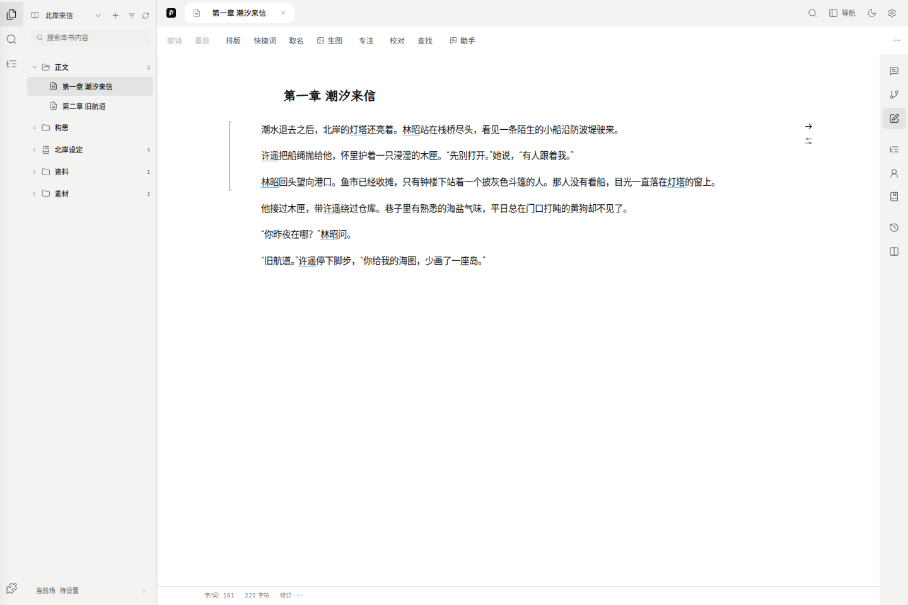
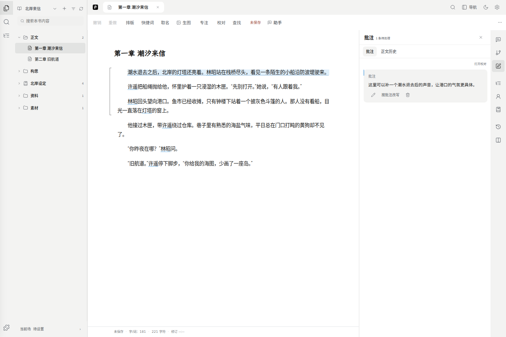
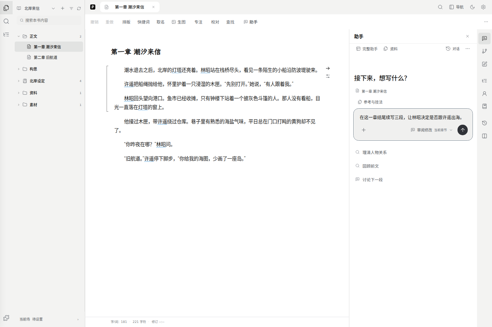
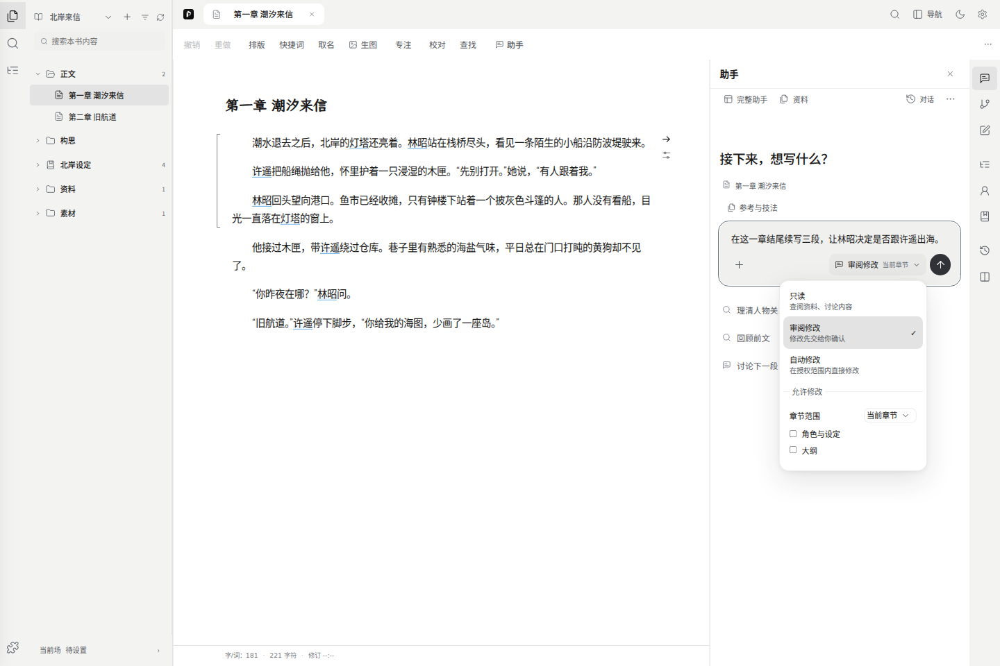
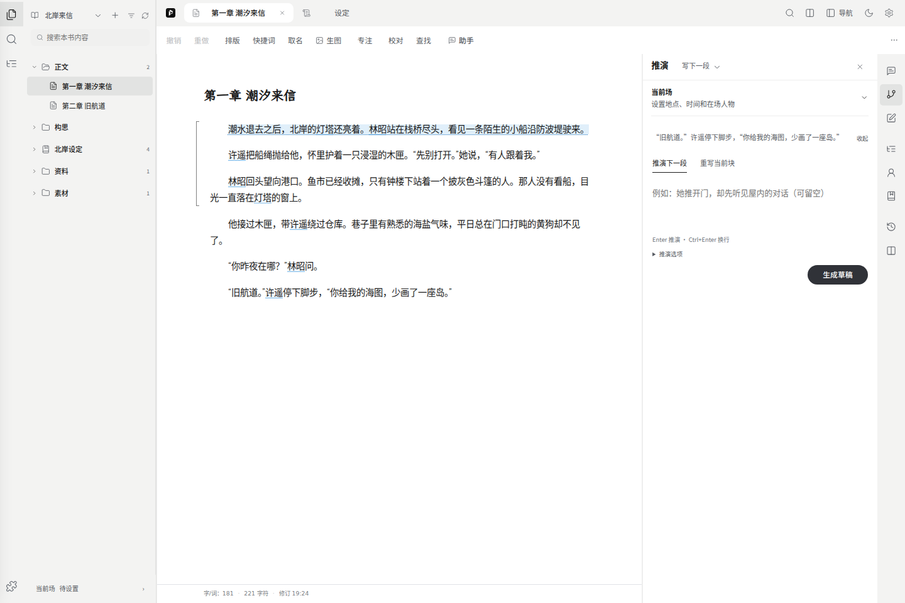
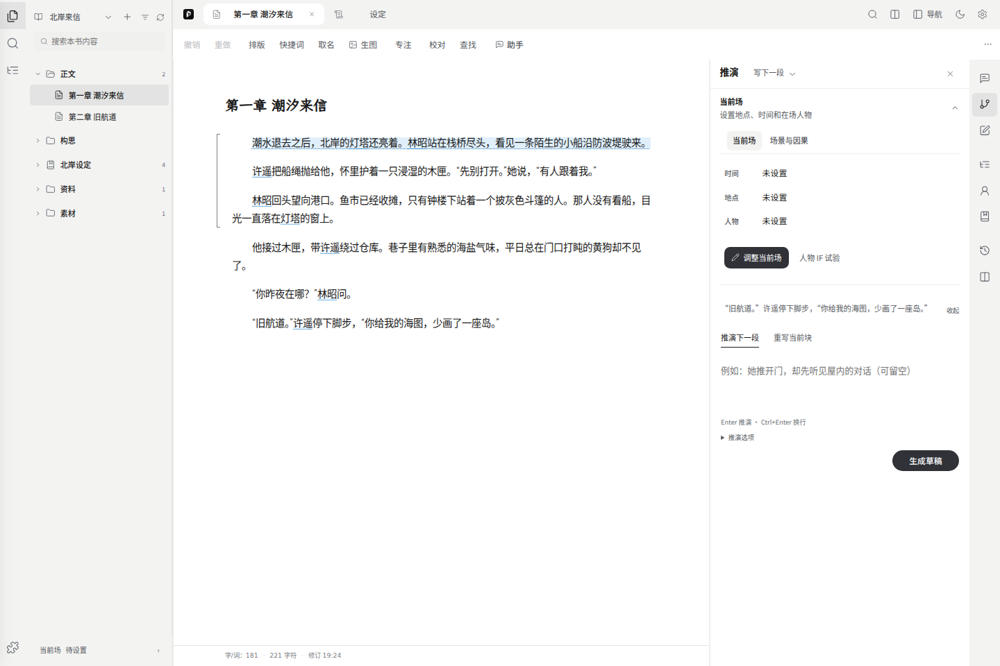

# 创作与写作

左侧目录负责找内容，中央编辑正文，右侧图标打开写作工具。章节顺序和文件归档是两个视图，具体见[快速开始](./01-quickstart.md)。

## 章节、构思和速记

点击左侧章名打开正文，章节按顺序列出；长标题悬浮可查看全名。“新建章”在当前作品中增加章节；“新建书”会开始另一部作品。章节菜单里可以重命名，也可以打开“历史版本”。

还没决定放在哪一章的片段，可以先写在“构思”里。打开一条速记后，点击稿面顶部标题即可修改；按 Enter 或点到标题外保存，按 Esc 取消本次改名。标题不能为空。改名只改变速记名称，不会改章节名。

“大纲”用于记录章节目标、冲突和转折，正文仍从章节列表打开。选中总纲或章纲后，直接改标题和内容，短暂停顿或离开输入处会保存；新建章纲后即可输入。目录仍可搜索、筛选和展开分组，章纲保留插入正文及排序操作。写在大纲或速记里的文字不会自动插入章节。

## 正文编辑和排版

点击正文输入，修改会自动保存。查看编辑区的保存状态；出现“已保存”才表示本次更改已写入当前浏览器。保存失败时先复制文字或导出当前正文，处理方法见[常见问题](./08-faq.md)。

| 入口 | 用途 |
| --- | --- |
| 撤销 / 重做 | 撤回或重做正文编辑 |
| 排版 | 调字体、字号、缩进、行距和文本块边界显示 |
| 快捷词 | 管理写作时常用的表达 |
| 取名 | 选择名称候选并插入文字；人物资料需要另建 |
| 专注 | 收起周边工具，按 Esc 返回 |
| 校对 | 查看语言检查建议，再决定怎样修改 |
| 查找 | 选择搜索范围，定位正文或资料中的内容 |

文本块边界用于区分编辑单元，开关边界不会向稿件添加符号。字/词数、字符数也不是模型 token 数；同一段文字在不同软件中的统计可能略有差别。

## 批注和局部改写

1. 拖选需要处理的原文，在浮条里点“批注”。
2. 写清想改什么、要保留什么，再点“添加”。例如：“把解释改成对话，但保留她尚不知道钥匙被换的设定。”
3. 批注会列在右侧；“编辑”修改意见，“删除”移除意见，都不会直接改原句。
4. 点“按批注改写”请求 AI 候选。检查候选后再采用；也可以放弃候选，保留原文。

批注可以先记着，以后再改。生成期间若原句已经变化，旧候选可能不再对应当前位置；重新选中要改的文字再生成，别把过期候选直接粘回。

选区浮条没出现时，先关闭正在操作的查找或校对面板，回正文重新拖选。不要在右侧回答、预览文本或章名上选字来添加正文批注。仍不出现时，按[常见问题](./08-faq.md)记录复现步骤。

## 助手

从右侧工具打开助手，边写边问；点 **完整助手** 可展开同一对话。中央标签切换展示，不会重新发送消息。助手不会因为展示修改建议就自动关闭侧栏。

助手知道当前作品和章节，并获得有限的目录、正文与相关设定上下文。需要更多内容时再调用查阅工具。这不等于每次都读完整本书；讨论具体段落时，选择原文或用 **参考与技法** 明确指定资料会更准确。

### 让助手修改正文

在输入区选择权限，再描述要求：

| 权限 | 会发生什么 |
| --- | --- |
| 只读 | 查阅和讨论，不提交正式修改 |
| 审阅修改（默认） | 提出修改，由你检查和采用 |
| 自动修改 | 在你授权的范围内采用修改；仍检查目标、修订和保存结果 |

修改范围先选 **当前章节** 或 **本作品**：当前章节只授权这章；本作品包含本书正文、设定和大纲。需要细选时打开 **自定义**，再勾选设定、大纲与具体章节。只读模式收起修改范围，正在采用时不能调整。没有章节时不能选择当前章节。切换焦点不会自动扩大授权。

权限按每次发送时的设置确定。生成中改权限或章节范围，会显示“下次发送生效”；当前任务及其自动采用继续使用发起时的授权。要停止当前任务，请点停止。手动采用已有建议时，仍按采用时的设置核对范围。

人物、设定和大纲的修改直接显示在原来的字段里：删除文字带删除线，新增文字用绿色标记，原目录和其他字段保留。标题旁的勾号采用当前对象的修改，叉号忽略；采用后点击“完成”收起标记，内容不变。“撤销本轮修改”会撤销这一轮已采用的修改。新增对象先在原目录中显示，采用前不会写入正式设定。正文仍在稿面原位显示修改。

要求续写或改写时，例如“在当前章结尾续写三段，不重复已经发生的事”。助手通过工具准备正文草稿，复用推演的规划、生成和检查流程。任务失败或输出不完整时会保留可用文字，但不能当作已完成的修改直接采用。

点击回答中的 **查看修改建议**，正文修改在中央书稿中展示；设定和大纲修改进入对应审阅位置。**采用这组修改**保存建议；**放弃**保留原文。采用后显示已保存的目标，可点 **查看位置** 返回正文；也可撤销本次修改，已有后续编辑时会先检查冲突。

聊天里说“写好了”不等于正文已经保存。以实际修改建议、采用回执和正文保存状态为准；只调用“查阅设定”“读取章节”也不等于调用了修改工具。

### 追问、重答与另开对话

| 操作 | 对会话的影响 |
| --- | --- |
| 继续发消息 | 留在当前对话，沿着已有问答继续 |
| 编辑提问 → 保存并重新生成 | 在原对话里生成新版本，不新建会话 |
| 重新生成、换参数重答 | 在原对话更新这轮回答，可切换保留的版本 |
| 另开对话 | 从选中的回答建立新对话，保留原对话 |
| 对话 → 新建对话 | 从空白话题开始 |

编辑按钮在提问旁，鼠标移入或键盘聚焦时可见。每轮最多保留 8 个版本；版本回看不会自动运行工具，也不会撤销已经采用的正文修改。要撤销写入，请用修改回执中的撤销入口。

顶部 **对话** 可切换和删除会话。删除需要确认；最后一条删除后显示空白对话。对话按作品保存，刷新不会自动重发问题，也不保证恢复正在生成的请求。

### 参考、技法与运行情况

- **＋** 可添加文件、章节或已有资料。文件先解析并加入本书资料库，再作为参考；移除输入区引用标签不会删除原件。
- **参考与技法**可选择需要查阅的内容和写作方法，也可输入 `@` 搜索参考。确认参考本身不会发送问题。
- 回答下方的来源可打开引用片段并定位原文。引用是生成时的资料，更新来源后应重新检索。
- **思考过程**和**已使用工具**可展开查看；工具失败时展开该项读取原因。顶部更多菜单可查看 **运行日志**。
- 参数设置影响本次助手请求，不会替你切换站点模型。连接成功与健康检查也不能证明生成质量。

本机部署可在绑定项目和安装知识运行包后使用知识检索。公网关闭本机文件能力；普通问答引用本书快照与本机知识库检索不是同一种接入。详见[设定与资料](./03-worldbook.md)。

## 生成插图

在正文选中一段，或把光标放进要配图的文本块，再点 **生图**。先核对来源，编辑画面描述，选择模型、比例和张数后生成；也可以先用“整理画面描述”从原文得到草稿，检查后再使用。

左侧是生成参数，右侧看当前图和本书候选。风格选项只补充描述，不会自行生成图片。每张成功结果会自动存入生图历史；**保存为素材**会另建素材条目，**插入正文**则把选中的图片放在原文本块后。这两个动作都需要你选择。

生成开始后，作品、章节和原文位置会固定。原文已经改过或切到另一部作品时，旧结果仍可查看、下载和保存到原书素材，不能直接插进新的位置。停止保留已完成图片；保存失败时用 **重试保存**，不要再生成一遍。

使用自配 ComfyUI 时，“停止”会停止等待和接收结果；已经提交到 ComfyUI 的后台任务可能继续运行，需要在 ComfyUI 中处理。

内置 MiniMax 可使用一张人物参考图（JPG/PNG，小于 10 MB）；参考的是人物外观，不保证逐格身份完全一致，也不等于支持蒙版或构图编辑。其他模型可用的参考数量随配置变化。图片已插入正文、存为素材或被漫画引用时，不能从生图历史删掉对应文件。

## 推演：续写或先试情节

打开右侧“推演”，默认从本章末尾继续；如果已经在正文里放过光标，就从光标处继续。上方摘录显示这次的接续位置。标题旁可以选择任务：

- **写下一段**：默认任务。可以直接点“生成草稿”，也可以先写要求。生成的草稿固定放在正文落笔处，按内容展开，可以直接修改；右侧“查看草稿”会定位到它。检查后点“采用”才会写入正文。
- **推演情节**：先在右侧试人物行动和后续发展。打开即可输入；留空点“推演”会承接当前情节，有要求时按要求推进。上方的原文摘录可点回起点。

如果先出现人物或地点候选，选入需要的项并保存；确认后会接着执行刚才的推演，不用再次提交要求。也可以选“暂不调整，直接推演”，沿用当前现场。

输入时按 Enter 提交，Ctrl+Enter（Mac 也可用 ⌘+Enter）换行。填写要求时不会反复读取参考；提交后才准备本次使用的正文和资料。生成中点“停止”可以结束本次等待。

### 继续、换路和比较

在“推演情节”中，根据最新结果补充要求，再点“继续推演”；不填要求则自然接续。点“接下来”的建议只会填入输入框，提交后才生成。“谁来行动”可以调整本次关注的人物。

想试另一种选择，可以点某一步的“从这一步重新推演”。“其他结果”用于恢复或比较已有走法；**… → 重新开始**重新确定起点。每条走法最多四步，达到上限后可换路或写成正文。

**… → 比较人物选择**可设定同一个人物的两种想法，分别看其行动。“返回推演”回到原面板，比较不会修改正式人物设定。重新开始后，可以先用“补充背景”增加本次走法的假设，再继续推演。

### 把结果写入正文

情节结果下方的“写成正文”会发起一次新的生成，把所选走法整理成正文草稿。检查草稿后再采用；已有草稿时点“查看草稿”，先处理它。生成、采用和保存是不同操作，保存失败时应重试保存。

生成期间正文或参考发生变化时，右侧保留结果供阅读和复制，不会自动写入正文。直接续写的保留结果可点“保存为构思”；点“修改要求”回到原输入，再点“返回生成结果”可以继续阅读。移动光标或收起右栏不会清掉已经生成的草稿。情节推演的异常结果不计入成功步骤。部分异常响应只能保留可读片段，界面会提示截短；没有保留文本时不能恢复完整输出。

推演草稿会按作品和文稿保存一份本机恢复副本。刷新后回到原文稿，可点“有一份未写入正文的推演草稿”查看；恢复稿可复制或保存为构思，不会沿用旧授权直接改稿。**保存为构思**会显示名称和打开入口，它不会写入章节正文。采用并确认正文保存成功后才清理恢复副本；浏览器存储不可用时请先复制文字。这个机制无法找回过去未曾保存的文字。是否重复、是否推进了情节仍需自己检查。

## 当前：人物、地点与时间

点击推演中的“当前”或左栏底部入口，再点“调整”。这里填写落笔处的时间、地点和在场人物，保存的是这一场的状态。

“从正文识别”区域会根据附近文字提出候选；点“重新识别”可以再查一次。人物候选点“选入在场人物”，地点候选点“设为当前地点”，最后点底部“保存”。只点候选、没有保存，仍是草稿；“取消”放弃本次调整，“撤销上次保存”在可用时撤回上一次场景保存。

当前识别主要匹配已关联世界书里的名称和关键词：

- 世界书中没有的人物，不会因为正文出现一个名字就自动建档。
- 提到一个地点，不一定表示当前就在这里；回忆、转述和否定句都需要自己判断。
- “附近没有待确认的人物或地点”只表示这次没找到新候选，不表示这一场没有人物。
- 普通输入不会每敲一个字就更新在场名单。准备推演时可能先提示确认；需要立刻核对时手动打开现场。

修改人物或地点资料本身，去“角色”或“设定”；调整这一场谁在场，打开“当前”进行调整。

## 正文版本和记忆记录去哪里看

| 要找的内容 | 入口 |
| --- | --- |
| 这一章以前写过的文字 | 右侧“批注 → 正文历史”，或左侧章节菜单“历史版本” |
| 故事事实、AI 提取候选和记忆修订 | “设置 → 记忆与历史” |
| 人物、地点、规则的设定内容 | 工作台“角色 / 设定”及关联世界书 |

“正文历史”保存的是章节正文和批注的快照，可手动命名保存，也可按字数节点自动保存；恢复前会先保留当前正文。它不是批注修改记录，也没有并排比较稿件的界面。速记不使用章节快照，需先打开章节。记忆记录不能代替正文备份。

## 英文、混合语言和备份

界面语言在“设置 → 外观”切换，不会翻译已有正文。

TXT / Markdown 导入可识别 `Chapter 1`、`CHAPTER IV: The Door`、`Prologue`、`Epilogue` 和 Markdown 标题；确认前看拆章预览。字/词统计按汉字及其他 Unicode 词计算，英文词内的撇号连接，连字符分开。

换浏览器、设备或网址前，使用“设置 → 备份与恢复”导出完整工作区 ZIP。导出正文只带走文字，轻量 JSON 也不能代替资料原件、媒体和记忆归档的完整备份。见[设置详解](./07-settings.md)。
