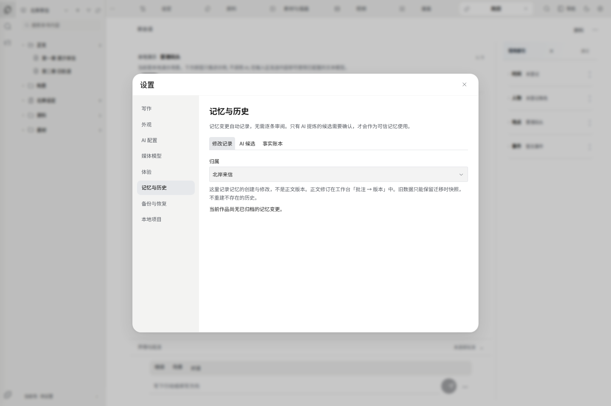
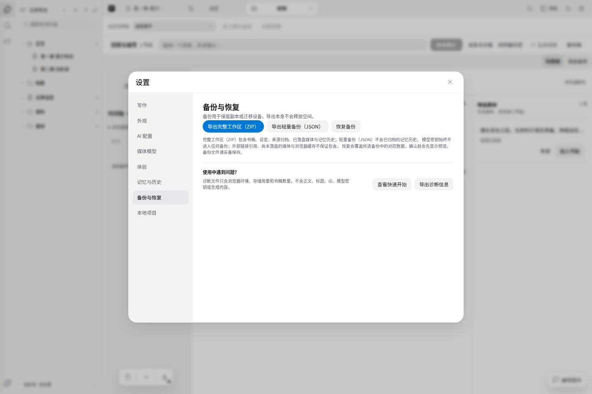

# 设置详解

从工作台打开“设置”，按左侧分区选择写作、外观、模型、体验、记忆与历史、备份与恢复或本地项目。

## 界面与助手语言

在“设置 → 外观”选择“简体中文 / English”；助手解释默认跟随界面，也可单独选择。偏好仅保存在此设备，不随工作区备份恢复。切换界面不会翻译正文、修改章节名、重置字体或重新生成已有建议。

界面语言和助手回答语言不会翻译已有正文。英文引文和改写片段保留原文语言；高级工具目前仍有部分中文界面。

## 写作

这里的排版偏好与正文工具栏共用并立即生效：

- 字体、字号、行距和段落间距。
- 首行缩进。
- 文本块边界：当前块、全部边界或隐藏。
- 打字机滚动和段落聚焦。

这些设置只改变写作与阅读方式，不改正文内容。正文自动保存始终开启；专注模式从正文工具栏切换。

## 外观

可以在 **日间**和**夜间**配色之间切换，也可以调整界面缩放。夜间模式还可从右上角快速切换。外观和缩放只影响显示，不修改作品。

## 记忆与历史

Pinax 的记忆由应用内的本地数据库管理，无需另行连接“记忆服务”才能使用。在 **记忆与历史** 中可以查看记忆内容、事实及其来源、决定和修订记录，也能检查数据库健康情况。正文旧稿在工作台 **批注 → 版本** 或章节菜单 **历史版本** 中查看。

当前实现以 Utopia 的时序事实账本为数据设计基础，并移植部分时序协调算法；Pinax 已在浏览器 Dexie/IndexedDB 中实现事实、证据、决定和修订记录，并由 Pinax 自己的代码读写，不连接外部 Utopia 服务。这不是 Utopia 完整认知/时态引擎的复刻：部分冲突处理仍需审阅，且并非所有作品数据都迁入同一个数据库。

先选作品。“修改记录”按时间从新到旧排列，点 **显示更多** 可以继续往前看。在 **AI 候选** 确认一条记忆后，登记正式事实仍需在 **事实账本** 接受相应提案或显式迁入旧记忆。完整工作区 ZIP 包含已归档的记忆历史和事实账本。

在 **事实账本 → 当前事实** 中，每次显示 50 条，点 **加载更多事实** 可以接着看。翻页时会沿用打开列表时的版本，点 **刷新** 可以查看最新修改。如果更正或撤回时提示事实已在别处更新，请先核对最新内容，再决定如何处理。

旧数据如果没有原始修订记录，只能保留迁移时快照，不能凭空重建历史。

### 小说世界模型

打开一本书，点正文顶部的 **⋯（更多写作操作） → 小说世界模型**，即可查看当前作品。也可以在设置的 **记忆与历史** 选一本作品，打开 **事实账本**，在 **视图** 中选 **小说世界模型**。例如，作者设定临川北门一直开放，林昭第三天却听说北门已封。

如果后来确定某条传闻属实，在 **世界陈述** 找到原说法，点 **证实这条说法**，填写事实成立的故事时点并确认。地点事件会出现在原地点的地图详情。之前听过它的人物保留当时的态度，先前的原文仍标作引述。

直接登记正式事实或证实传闻时，可在 **出处章节** 和 **出处段落** 选择作者据以判断的原文。地图的事件原文中会标为 **作者认定事实的依据**。

登记状态或盟约时，如果只知道某天成立，可勾选 **只确认起点，结束日期不确定**。知道最晚何时已结束时，可补充上限。在两者之间查询，工作台会提示日期不足；后续得到确证可点 **更正持续情况**。

登记围城、远航等事件时可选 **持续一段时间**。填写开始日期和从何时起已经结束；两端可以位于同一历法的不同纪元。地图显示期间，分别更正起止日期可保留另一端。

打开世界书条目的上下文，展开 **本书世界模型**；本章末段有故事时点时，可以查看当时与条目有关的正式事实，以及该人物当时听过什么、对消息持什么态度。在正式事实下点 **查看全稿出处** 可打开对应段落，点关联条目的名称可继续检查另一方的设定。地图上的 **事件发生的故事时点** 用于查某一天，**事件记录截至** 用于回看作者更正前的记录。

在 **用稿检查** 选定起始段落，登记 **创作约束** 时可选 **约束结束章节** 和 **约束结束段落（含）**。范围内各段都能查到这条约束，结束章之后的段落不受它影响。改稿后可在 **失效的稿面关联** 核对两端。

若把消息记在了错误的人物名下，在 **人物所知 → 获知与态度记录** 中撤下该次经历。另一条独立获知会保留；若某次态度变化完全依赖这次消息，先核对该态度。

在 **读者已知** 中，若一句伏笔被误登为揭示，可点 **撤下这条揭示**，核对原章和原句后确认。若只是将揭示移到另一章，点 **重新定位揭示** 并核对目标段落。原章节已删时可从 **用稿检查 → 失效的稿面关联** 找回原句。同一段其他人的引述各自保留；填入撤下前的记录序号仍能回看。

在世界模型点 **创建试写分支**，填分支名并选填正史记录序号。创建后在 **设定版本** 切换正史与分支。分支沿用本书正文，独立保存事实更正、人物所知与稿面引述。在分支的 **人物所知** 选中角色，点 **从分叉点继承此人物经历** 可带入该角色当时的见闻和态度。此操作仅适用于尚无分支经历的角色。进入分支后点 **对照分叉点**，可按故事时点辨认改动。选择 **核对并采纳到正史** 可核对原有用稿，再确认采纳选中的版本。在地图地点的 **事件记录截至** 填入更正前的记录序号，可以看到当时登记的地点与原文。在 **事件设定版本** 可切换分支，核对该版本的事件与关联段落。

在 **读者已知** 登记引述时可选择说话人。若署名写错，在对应引述点 **更正说话人**；旧记录序号仍显示原署名。

要写“林昭没有去过南楼”，可在添加陈述时勾选 **否定这条陈述**。若已有到访记录，在它旁边点 **登记相反说法为传闻**，可以让两份证词明确指向同一次到访。在同一日证实两种说法后，作者的时间回看会提示冲突。

登记数值时可另填单位，例如过桥费为 0 文。登记开关、资格等设定可选布尔值。事实账本的 **更正** 支持调整数值、单位或是非。

在关系或状态旁可点 **登记结束日期**。例如第一天与书院结盟，第四天起解约，第八天重新登记同一盟约。查询第二天仍有盟约，第五天为空，第八天重新成立。

若迁居日或事件日写错，在该条正式事实旁点 **更正故事日期**。若上一段状态的终点由这次迁居推算，系统会同步调整终点。

在 **世界陈述 → 作品历法** 新建一本书的历法，按故事先后排列纪元。登记和回看正式事实都可选择历法及纪元，地图也会采用作者填写的名称与顺序。在当前场景、人物获知与行动依据中选择相同历法与纪元，就能核对该人物在这一天是否已经得知消息。不同历法里的同一序号分别解释，无法排序的认知变动会在人物回看时提示。

在 **人物所知** 选择“听说”后，可填写 **听谁说的**，也可选择稿中交代这次获知的章和段。展开 **获知与态度记录** 能看到当时登记的原句。人物心理推演会保留传话者的姓名。

在 **用稿检查** 登记“人物依据信念行动”时，选取行动人物与故事序号，会保存该人物当时听到的说法和态度。更正人物认知后，点 **检查人物行动依据**，可定位需要改写的原句，或撤下已失效的依赖。同段其他人物分别核对。

1. 在 **世界陈述** 分别登记“北门开放”为正式事实、“北门已封”为传闻。选世界书条目作对象可以区分同名人物或地点。一次到访选“一次事件”，第二次到访另记一条。要记“林昭在南楼把印交给青禾”，可以直接添南楼为发生地，再为林昭和青禾分别填“交付人”和“收件人”。回看正式事实时可填写故事时点和记录序号。
2. 在 **人物所知** 选林昭和“北门已封”，记下第三天听说。若他因此信以为真，再记录一次相信。后来他亲眼查证并推翻传闻，回看第五天仍能还原当时的态度。展开 **获知与态度记录** 可以看到每次听说、目击或改变看法。录错了日期或途径，在最新记录视图点 **更正此条记录**。按更正前的记录序号回看，仍会显示当时的版本。若改动会让人物先表态后获知，请先核对相关的态度日期。
3. 在 **读者已知** 选章和段落。角色台词选“引述他人说法”，作者明确告诉读者门开则选“叙述者断言”。换到前一段，可检查读者是否已经得到这条消息。场景设有视角人物和故事序号时，点 **查看此段视角人物当时所知** 可直接切到该人物的记录。新登记的关联在后面续写新章或新单元时仍有效。需核对删章前读者看到的内容时，在 **阅读的稿面版本** 选择一次登记，再选当时的章和段落。系统同时填入该次登记的记录序号，可单独调整。旧版登记使用全书顺序核对，遇到位置变化提示时可在当前段重新登记。
4. 在 **用稿检查** 登记正文依赖的事实或人物信念。要追查旧稿，先选 **阅读的稿面版本**，再选当时的章节和段落。记录序号可单独调整，能查到今天已经删掉的章节当时采用的设定。要改一条正式设定，可以先预览会影响本书哪些已登记的段落。更正后选新事实重新复核。如果原段已经删除，可在失效关联中看原句并撤下旧关联。

在地图选择已绑定的地点，**地点关联事件** 会列出本书以它为发生地、主体或对象的已确认事件。若地点写错，在世界陈述点 **更正事件地点与参与者**。地图会把事件移到新地点，角色先前听到的说法仍保留。不同历法和纪元分别排列，同一纪元内按故事序号排列，缺少日期的事件仍会列出。点事件下的 **查看关联原文**，可跳到仍能核对的正文节点。事件更正前登记的段落标记为“旧版说法”，已经改写的段落保留登记原句。同名地名的文字提及仍可单独查阅。完整工作区 ZIP 可备份这些记录。

## 模型

**写作本身不需要配置 AI。** 只有使用问答、改写、推演、生图或视频等相关功能时才需要可用的模型渠道。

### 站点提供的内置渠道

在“模型 → 文本”中，“服务器模型”是不可编辑、不可删除的默认配置，由 pi-agent 内核持有密钥。普通用户可以选中该配置并点 **测试连通性**：

- 测试成功后再使用相关功能。
- 出现「未检测到可用模型」时，说明站点的 Agent 任务面没有运行，记录错误并联系站点部署者；普通用户不需要修改服务器文件。

浏览器不会接触内置渠道的真实密钥。图片和视频的内置渠道另由部署者配置（依赖服务器环境变量）。

### 自建环境：添加自己的文本模型

公网版本不允许访客修改服务器模型。下面的操作适用于开放模型配置能力的本机或自建环境。

点 **添加模型配置**，按界面填写名称、渠道、API 地址、API Key 和模型，然后保存并测试连接。可选渠道和默认模型可能随版本变化，以当前界面和渠道官方说明为准。

自定义配置列表保存在当前浏览器。在助手输入区点击模型名称可直接切换，列表底部“管理模型”打开统一设置。每次发送或重新生成使用此刻选定的模型和权限，发出后冻结；期间切换只影响下一次请求，不热改运行器的默认模型，也不中断当前任务。助手委托推演写正文时继续沿用本次模型。所有文本请求仍经过后端与内核，不增加浏览器直连通路。换网址、浏览器或设备时不会自动带过去，且不会进入作品备份；请用安全方式另行保管密钥，不要发进反馈、截图或公开仓库。

文本、图片和视频配置都集中在“设置 → 模型”，使用顶部分类切换。模型名以你自己填写的为准，界面里的已知名单只作输入建议。

### 图片与视频

生图和生视频各自有一条独立的模型链，在 **设置 → 模型 → 图片 / 视频** 里选择和管理：图片配置供插画、漫画分镜共用，视频配置供分镜视频使用。这里选中的配置就是这些功能实际使用的配置，在对应工作台里切换也会同步回来。

每个分区下面是同一套配置入口：

- 工作台里的模型名称打开已有配置列表；“管理模型”进入对应分类，添加、编辑或删除配置。
- 类型可选内置渠道、OpenAI 图像、Stability、Stable Diffusion WebUI、ComfyUI 或通用 HTTP；视频可选内置渠道或自定义异步 HTTP。
- 名称、API 地址、API Key、模型 ID 按渠道当前说明填写；模型 ID 不限于界面建议的名单，新模型名可以直接填。
- 面板里的 **测试连通性** 只验证能不能连上，不代表生成一定成功。

标记为「内置」的配置由服务器持有密钥，浏览器不接触，不可编辑也不随备份导出；其余自定义配置和密钥只保存在当前浏览器，换网址、浏览器或设备后需要重新添加。

## 体验

这里调整体验模式的单次续写篇幅和阅读密度。它影响之后的生成长度或当前显示，不会改写已经显示的正文。

## 备份与恢复

先按用途选择导出方式。导出会下载文件，不会删除工作区中的内容：

| 方式 | 包含 | 不包含或不保证包含 |
| --- | --- | --- |
| 正文导出（在工作台使用） | 当前正文或书稿文字，适合到其他编辑器继续写 | 设定、来源文件、媒体、记忆和工作区状态 |
| 完整工作区 ZIP | 书稿、设定、来源归档、已落盘媒体、记忆历史和事实账本 | 模型密钥；外部链接引用、尚未落盘媒体和浏览器缓存不保证包含 |
| 轻量 JSON | `localStorage` 中的作品、设定、设置和常用记录 | 模型密钥、来源原件、媒体原件、已归档的记忆历史 |

换浏览器、设备或网址时：

1. 在原环境导出完整工作区 ZIP，确认下载文件已保存。
2. 在新环境打开“设置 → 备份与恢复 → 恢复备份”，选择这个文件。
3. 等待校验，检查预览中的新增、覆盖、跳过和无法恢复项。若新环境已有稿件，先给它导出一份备份。
4. 确认恢复，等完成提示后打开作品，核对章节和重要资料。出现失败提示时先保留两边数据与备份文件。
5. 自定义模型配置和密钥需要在新环境重新添加；界面语言、助手语言等设备偏好也需要重新设置。

ZIP 恢复预览中的覆盖数量包含已有资料和媒体。恢复较早的书稿后，如果绑定文件夹里有更新的版本，本地化中心会提示同步冲突，磁盘稿仍可核对。ZIP 和 JSON 用于恢复工作区。TXT / Markdown 稿件可从首页“导入书稿”进入。

如果预览后又在另一页保存了章节，确认时会看到更新后的预览。请对照刚保存的稿件，再决定是否恢复备份。

较大的书架会按章保存。需要回到旧版 Pinax 时，先在当前版本导出备份。旧版无法直接读取新版的按章存储格式。

## 本地项目

本机部署可以在这里绑定项目目录，供项目文档阅读、世界书文件接缝和知识检索使用。公网会关闭此能力；浏览器导入文件不等于获得任意磁盘访问权。知识检索还需要部署者安装独立知识运行包。

绑定目录不会把所有浏览器数据自动搬到磁盘，解除绑定也不应被当作删除书稿。具体文件保存和恢复请以绑定状态及保存回执为准。

在“本地化中心”清理浏览器缓存时，Pinax 会复核项目文件。假如浏览器里同时有绑定作品和只存在本机的作品，整个书架都会保留。共享的来源归档、资料工作区以及预览后改动的内容也会保留。

## 数据位置

作品主要保存在当前网址、当前浏览器中，没有自动云同步。协议、主机名或端口变化都会形成不同网页来源；迁移网址前要在旧网址导出备份。无痕窗口、清站点数据、浏览器清理工具、存储配额或设备故障都可能影响内容。
