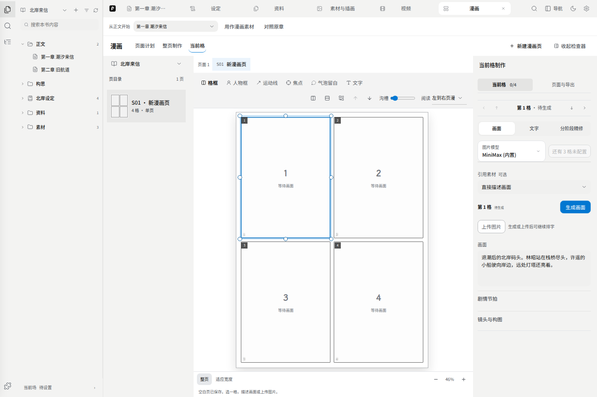

# 漫画

在左栏点击 **新建 → 漫画页**，会为当前作品保存一张四格空白页，并直接打开制作界面。也可以从作品导航展开 **更多工具 → 漫画**。先确认左侧作品名，再选择改编素材、生成分页方案、逐格制作画面。工作区右上角 **从正文生成** 可选择整章，或在正文预览里划选一段，点击 **从整章生成分镜／从选段生成分镜** 直接开始分页规划；手机也保留入口文字。漫画内容归属当前作品，修改漫画不会直接改正文。

## 开始方式

- **从正文生成**：选择章节后可直接生成，也可在预览中选取一段；点击 **使用整章** 撤销选段。生成结果进入页面计划，选择方案后点击 **开始制作**，即可逐格生成画面。改编使用一份带章节出处的正文快照，不修改原章；生成失败可以在页面计划重试。单次超过 16000 字时需要选段，不会悄悄截断整章。
- **从已有素材改编**：展开页面计划内的 **改编内容**，挑选一段或多段素材，点击 **生成分镜**，再比较生成的候选。先检查每页节拍、对白/旁白和画面描述是否忠于原文；模型生成的方案是草案，不是自动定稿。
- **新建漫画页**：跳过改编，直接做单页；空书里也可以在空态一键建立空白页，不需要先配置模型。选一格、填写画面描述并选择图片模型后即可生成，原文素材可选；也可在当前格的 **画面 → 上传图片** 直接放入 PNG、JPEG 或 WebP（不超过 20 MB），不需要配置模型。

## 页面计划

多页改编先落成**页面计划**。有候选后，逐页检查格数、页间节奏、对白和画面描述；必要时调整或重新生成，再明确选择要继续制作的计划。模型不可用时，可以改用 **新建漫画页** 手动开始，不要把空白页误认为生成失败。

通过页码选择或左右箭头切换页面。标题、剧情摘要、各格画面和已有对白直接编辑，输入随内容增高；翻页衔接、动作与旁白按需展开。方案通过顶部选择框切换，视觉规则在独立标签查看和确认。候选中的修改会随选定方案一起建立漫画页。已经建立的序列需要点击 **保存本页修改**；页间切换会保留尚未保存的修改；离开计划或进入制作前，需要先处理未保存内容。点击 **制作这一页**，直接进入对应页的构图和画面制作。

修改脚本里的对白后，还要到制作页的 **文字** 检查气泡内容。已经排入画面的文字和位置会保留，不会被脚本修改自动覆盖。工作区顶部可切换 **页面计划／整页制作**；独立页面的手机入口使用 **漫画制作模式** 下拉框。

## 页目录

桌面工作区直接使用左侧项目目录中的 **漫画** 文件夹切页，点击漫画页打开原件。只有一页时不额外显示页列表；有多页时画布上方可快速切页。独立漫画入口、手机以及旧漫画归属处理仍保留漫画页目录；页面计划使用页码切换，素材选择收在 **改编内容**，不另占一列目录。

- 两本书各自打开漫画，互相看不到对方的页、来源与候选；共用同一本世界书也不会混页
- 早期版本遗留的**未归属旧漫画**会单独放在目录底部的隔离区，只读展示，不参与生成与导出；可以用「归入本书」显式收编

## 从候选走到成稿

先打开 **整页制作** 并选择一页，再依次完成构图和画面。建议每页先校正文案、对白归属、人物位置与阅读顺序，再开始生图；否则反复生成会把时间花在修正计划本身。格子和文字框都要逐项检查，尤其留意对白是否挡住关键动作、气泡顺序是否符合阅读方向。

## 编辑与保存

网址会记录当前作品、漫画页和格。工作区标签与网址定位用于恢复已记录的页/格；首页最近打开只按作品汇总。指定页或格已不存在时会提示重新选择，不会替换成另一页。

右侧编辑区按任务分成三项：**画面**用于描述、生成或上传；**文字**用于对白、旁白和排字；**分阶段精修**用于逐步确认草图、线稿等产物。格编号旁的 **页面与导出** 图标打开页面格式、质检和导出；点击返回箭头回到当前格。收起编辑区后，点击右上角的侧栏图标即可重新打开；悬停显示操作名称。手机通过 **页面／当前格** 切换画布与编辑区。

- 页标题、画面描述、对白、旁白在失焦或换页时自动保存；输入未失焦就刷新页面，内容也会先保存再离开
- 保存失败时会留在原页并提示重试，避免换页丢失尚未保存的文字
- 改动画面描述、剧情节拍或来源后，旧阶段产物会标记失效，需重新核查再确认
- 长对白输入框自动增高，不会在框内滚动

右侧 **画面** 标签旁保留 **一键补齐**，用于生成当前页尚无画面的格子；手机先切到 **当前格 → 画面**。空白页也能看到按钮，画面描述未填齐时暂不可用；可先从正文生成分镜，或手动填写。改编页还需确认视觉规则。已有画面的格子不会重复生成。

点击候选缩略图先打开大图，不会立即替换画面。可用左右箭头查看其他候选，点击对比图标同时查看当前画面与候选；确认后点 **选用这张**，中央漫画页随之更新。手机对比按上下排列。只生成一张时也可以打开查看原图；按 Esc 或关闭图标返回。

描述、当前模型、上传图标和生成按钮集中在同一个输入区。已有画面的取景与文字位置调整收在 **调整取景与文字位置**；剧情节拍和镜头按需展开。分阶段精修复用同一套候选预览，**选作当前候选** 后仍需 **确认采用** 才能推进后续阶段。

画布下方 **本页画面** 按格显示已有画面、生成中、失败或待恢复；点击回到对应格，阶段任务会打开对应精修步骤。这是本页状态概览，刷新前未返回的图片仍需核查，不代表供应商提供了可恢复的后台队列。

## 生成请求的可靠性

- 双击生成只会发出一次请求；请求在途时按钮禁用
- 生成请求发出后修改了这一格：新图仍会进入这一格的候选区，但**不会自动替换**当前画面，会提示「候选未自动选用」
- 模型明确返回失败时，显示具体原因并允许重试；不会把额度不足、参数错误等都归为“结果未知”。
- 切换面板后仍在运行的请求继续显示生成状态。刷新或网络中断后若没有完整结果，会先尝试找回本次请求已归档的图片；仍找不到时可选择 **核查结果** 或 **重新生成**，不会自动重复调用模型。正在生成时刷新页面，浏览器会提示确认离开。
- 生成成功但图片保存失败时，可以「只重试保存」，不会再次调用模型

## 视觉圣经

改编时会把角色长相、地点、道具等设定汇成**视觉圣经**，让同一角色 / 场景跨页保持一致。视觉圣经可以增删来源、锁定不变量，并跳回 [世界书](./03-worldbook.md) / 地图 / [素材](./04-materials.md) 核对。

## 构图

整页制作区是**中央构图工作台**。顶部图标切换格框、人物框、运动线、焦点、气泡留白和文字，悬停可看名称；窄屏工具栏可以横向滚动。工具栏末端 **画布设置** 可调整阅读方向和所选格的间距，点击 **应用** 保存；关闭窗口或按 Esc 取消本次调整。

- 格框可以拆分、合并、八向拖边、调沟槽、改阅读顺序
- 画布支持**页漫 / 条漫**
- 每格可叠**人物调度框、运动向量、视觉焦点、地平线和气泡安全区**
- 右侧编辑区可以用右上角的侧栏图标折叠，画布随之扩大
- 底部的 **整页 / 适应宽度** 和缩放按钮只改变查看尺寸，不改变画布尺寸或导出分辨率；页漫默认看整页，条漫默认适应宽度

格框与沟槽会进入整页预览、单格生图比例、图片裁切和导出。

## 分格制作

按格推进。彩色路线是 `草图 -> 线稿 -> 平涂 -> 上色 -> 效果`，黑白路线是 `草图 -> 线稿 -> 网点 -> 效果`：

- 每阶段可生成图片、上传替换、切换候选并确认采用
- 参考和**局部遮罩修订**随模型能力开放。内置 MiniMax 目前支持一张人物外观参考；不能据此用于后续构图编辑或蒙版修订。需要图生图的阶段可换支持的模型，或手动上传并确认图片。
- 后一阶段要求前一阶段已确认；视觉圣经或上游变化后，旧产物会失效
- 生成结果只进入「待审」候选，需要明确「确认采用」才会成为该阶段成稿
- 当前选图会同步到整页、取景和目录缩略图。中间阶段可以预览和导出分镜草稿；成品导出需要有效的最终阶段确认，不能用待审或失效图片冒充成稿。直接生成并选用的单幅画面仍可用于成品导出。

## 文字与导出

- 对白、心声、旁白、拟声支持横 / 竖排、字重、旋转、气泡尾巴
- 字号按导出画布的像素设置，预览随画布缩放；同一气泡的形状、尾巴和字号同时用于预览与导出。文字太多时请扩大框、缩小字号或删减文字，成品导出会阻止溢出，不会直接省略后半句。
- 出版质检检查文字溢出、文字框重叠、焦点遮挡和安全区；点击质检条目可以直接跳到问题所在的格
- 整页导出 **PNG / WebP / PDF**；竖向条漫按格框边界切片。导出开始时会锁定当前页快照，导出过程中的修改不会混进文件
- 有格子缺少最终画面时，成品导出会被阻断并说明缺哪几格；此时可以导出带水印的「**分镜草稿**」

## 与其他工作区的关系

[视频与编导助手](./06-storyboard.md) 排好的分镜镜头和已有素材，都可以作为漫画改编的输入。漫画完成后可导出成品；需要改动故事文本时，回到正文或对应原件编辑。

## 生成进度与连续生成

单张图片生成时显示活动进度条、已等待时间和保存阶段。模型接口没有返回真实完成比例，因此单张不显示猜测的百分比。整页批量生成显示已处理格数和百分比；处理完不代表每一格都成功，失败会留在对应格。

内置 MiniMax 整页批量生图最多同时处理两格。需要上一格图片作为参考的其他渠道仍顺序生成。模型排队和单张响应时间仍由服务决定。

一张生成完成后，可以继续点击 **重新生成**；已有候选会保留，不会阻止下一张。刷新或断网导致结果未知时，先点 **核查结果**：系统按请求编号查找本作品、本页、本格的已保存图片，找回后加入候选并解除请求占用。没有找到时不会假装成功，也不会自动重复收费请求；可以明确选择重新生成。

图片已返回但保存失败时使用 **重试保存**，该操作不会重新调用模型。
