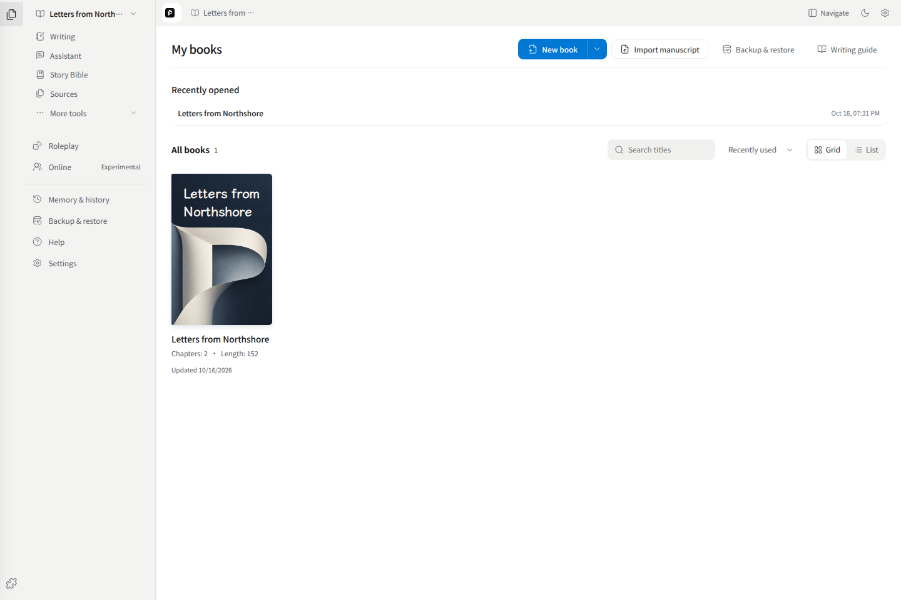
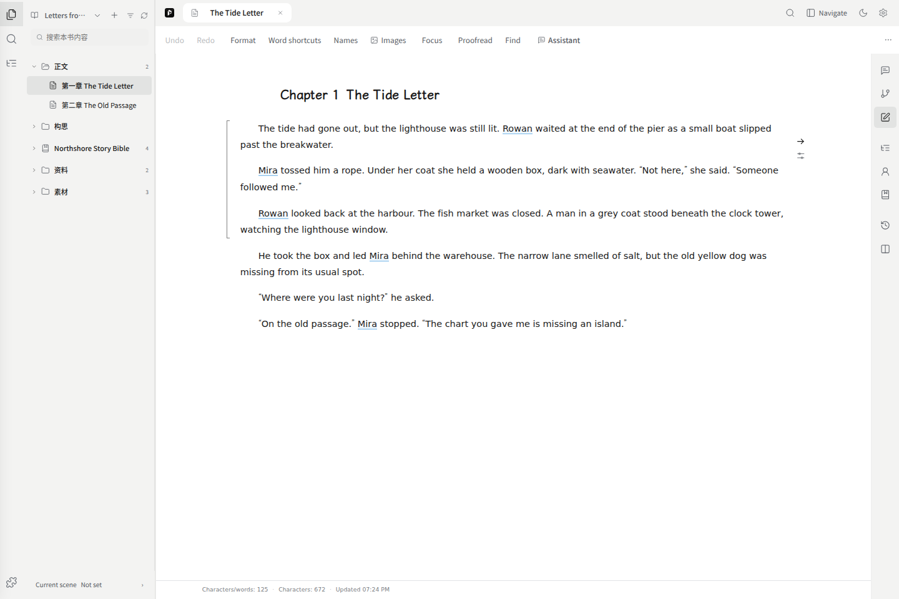

# Quick start

## Open a manuscript

Create a manuscript on the home page, or import TXT / Markdown and review the chapter preview before confirming. Import PDF and Word reference files through Sources; they do not automatically become chapters.

Open existing work from the library or recently opened list. That list groups by manuscript.

## Find your content

The left directory has default folders for manuscript text, notes, settings, sources, materials and comics. The story-bible folder uses its actual name and groups entries such as characters and places. You may create folders and mix supported content types.

Right-click a folder and choose **New** to create a chapter, note, setting or comic page, or import a source into that folder. **New folder** adds a child folder. Enter saves a folder name; Esc cancels. The top **+** remains available.

Drag between rows to reorder the directory, or onto the middle of a folder to move content into it. A line or folder highlight shows the destination. **Move to…** provides a keyboard and touch alternative. Clear search and filters before dragging; automatic character/place groups cannot be moved. Removing a folder moves its contents to its parent without deleting the originals.

Use the left activity icons to switch between files, search, manuscript order and extensions. Hover to see the names. Organizing folders does not change narrative/export order; use the manuscript-order view for volumes and chapters.

Central tabs reopen the original content. Select a chapter tab to return from a source or setting. On desktop, opening manuscript text expands the directory; returning home preserves its visibility. On mobile, select content through the directory drawer.

## Start writing

Open a chapter and type. Changes save automatically; use typography controls for font, spacing and indentation. If saving fails, keep the page open and copy unsaved text before retrying.

Right-side tools provide annotations, the assistant, rehearsal, outline and setting references. They are optional.

## Add a character or source

Create a setting entry from the directory, choose its name and type, and write its body. Expand properties only when needed. To import sources, open the file-import dialog, add files or pasted text, inspect the parsed result and confirm.

## Try the assistant

Ask a specific question, for example: “Keep this passage's facts, but make the dialogue more natural.” The default permission is review before applying changes. Read-only mode discusses and retrieves; automatic mode applies within the scope you explicitly authorize.

Proposed manuscript changes appear in the manuscript for review. A chat response alone does not mean text was saved. See [Writing](./05-writing.md#assistant).

## Back up

Export manuscript text for use in another editor. Use a full workspace ZIP to move manuscripts, settings, archived sources and saved media.

Before changing HTTP to HTTPS, hostname, browser or device, export from the old location and restore at the new one. These locations do not share browser storage. See [Settings](./07-settings.md).
