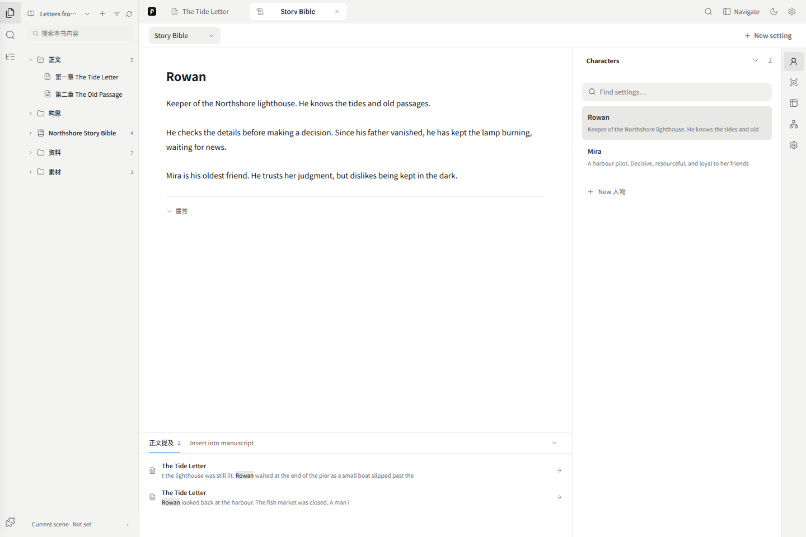
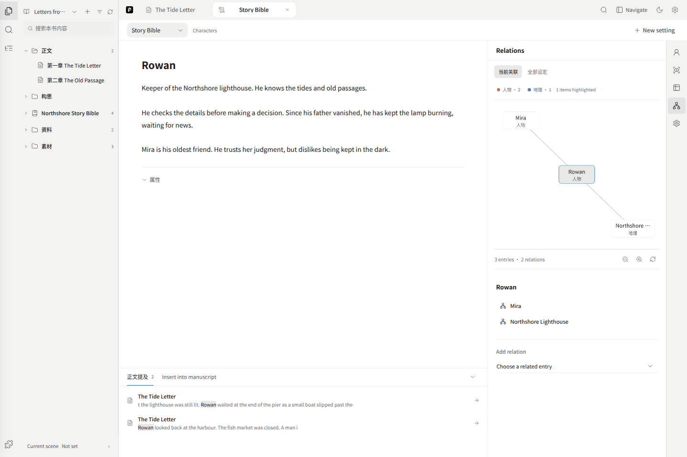

# Story bible and sources

A story-bible entry records the characters, places and rules you maintain. A source provides reference material. Importing a document does not make all its claims established story facts.

## Write an entry

Open a character or place from the manuscript's story-bible folder, or select it in the settings collection. Both edit the same entry.

Create an entry with a name and type, then write directly in its title and body. Body edits save on blur or a guarded switch; Ctrl/Cmd+S also saves. Expand properties to use a template or add fields. A long form is not required before writing.

If structured fields disagree with your edited body, choose whether to save fields while retaining the body or explicitly replace the body. Pending or failed saves must be resolved before switching. The older grouped settings remain under the optional creative-foundation section.

A manuscript uses its linked story bible. Books deliberately linked to the same bible share those entries, rather than getting private copies.

## Right-side tools

| Tool | Purpose |
| --- | --- |
| Related category | Find and open entries by type |
| Scenes and experiences | Inspect recorded appearances, locations and associated history |
| Table | Edit entries and fields in rows; expand the table when needed |
| Relations | Inspect the selected entry and direct links, or switch to the full graph |
| Manage | Edit management information for the current entry |

The graph stays on the right while the body remains in the center. Scene history comes from recorded manuscript scene anchors and story-bible history. Merely mentioning a name does not establish presence or current location. A mapped place can open the existing map; missing map bindings are not guessed.

## Bottom panel

Manuscript mentions match names and aliases in this book. Open a result to locate the passage; ambiguous names still require your judgment.

Insert into manuscript inserts the entry's name at the saved cursor in an opened chapter. An existing selection is not replaced; insertion goes after it. Check the target chapter shown in the panel. The insertion can be undone in the manuscript. It does not copy the entire profile or create new historical facts.

## Import reference material

Use the source/file import dialog. Drop files, choose them or paste text, wait for parsing, inspect the result and confirm addition to this book.

Supported formats include TXT, Markdown, DOCX and PDF. The current per-file limit is 100 MB for PDF and 50 MB for other formats. This does not mean a model reads the entire file at once. Scanned PDFs may require OCR first.

The archive holds parsed text and source metadata; keep the original PDF or Word file separately. The source reader is read-only.

## Three different source capabilities

- Imported sources belong to the book's source archive and can be read, cited and used for extraction.
- Project documents are read-only documents from a bound local project.
- Local knowledge search needs the separate knowledge runtime and project binding. Its derived index does not replace original files.

The public deployment disables local-file and local-knowledge interfaces. Ordinary assistant citations can still refer to the supplied book snapshot. A knowledge-tool capability flag is not proof that a local runtime or source file is available.

Review extracted names, aliases and evidence before applying them to official entries. Memory proposals and the fact ledger are available in Settings → Memory & history. See [Settings and backups](./07-settings.md).
