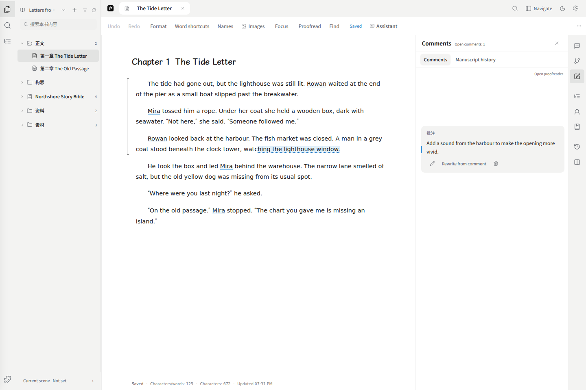
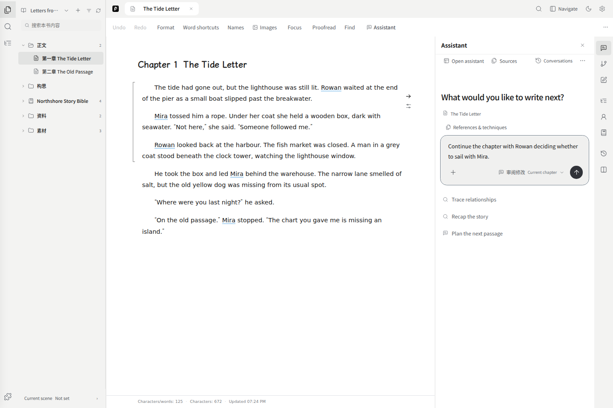
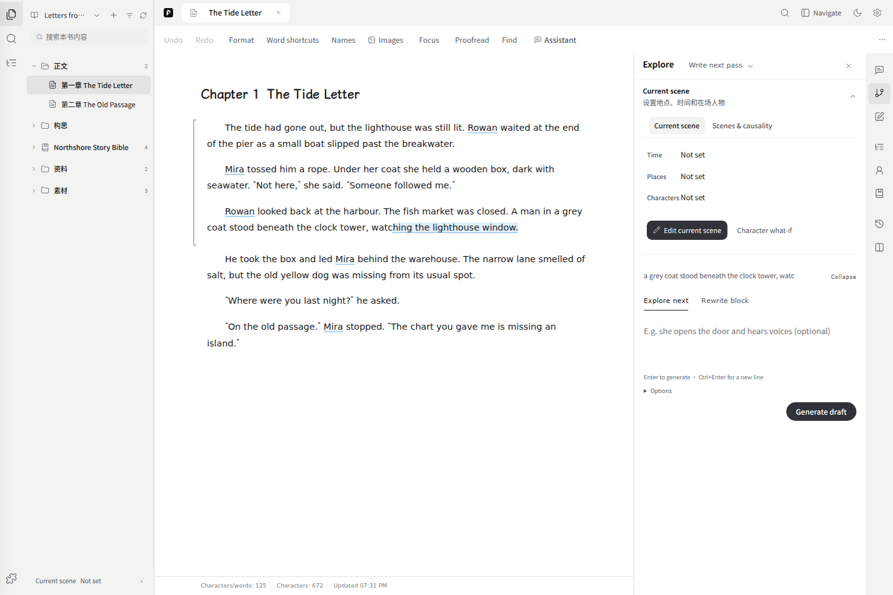

# Writing workspace

Use the mixed project directory to open content, the central editor to write, and the right tool icons for writing tools. Switch to manuscript order when arranging volumes and chapters; folder placement is separate. The current-scene control stays at the bottom. Hover or focus an icon to see its name. See [Quick start](./01-quickstart.md) for the workspace layout.

## Chapters and notes

Select a chapter to edit it. The chapter menu offers renaming and **Version history**. New chapters belong to the current manuscript; a new manuscript is a separate work.

Use **Notes** for passages you have not assigned to a chapter. Open a note and click its title at the top of the editor to rename it. Enter or clicking outside saves; Esc cancels the title edit. An empty title is rejected. Renaming a note does not rename its linked chapter.

The outline describes what a chapter should contain. Writing in an outline or note does not insert the text into a chapter.

## Editing and saving

The manuscript autosaves in this browser. If saving fails, copy or export the visible text before refreshing.

Formatting changes font, spacing, indentation and block-boundary display. These display settings do not add characters to the manuscript. Focus mode hides surrounding controls; Esc returns. Search locates text in the selected scope. Proofreading provides suggestions for you to check.

## Comments and rewriting

1. Select text in the editable manuscript and choose **Comments**.
2. Describe the change and what must remain, then add the comment.
3. Use **Rewrite from comment** when ready. This step needs a text model.
4. Compare the candidate with the original, then apply or discard it.

Editing or deleting a comment does not change the source passage. If that passage changes, an older candidate may no longer be applicable. Select the updated text and generate again.

If the selection toolbar is missing, close active search/proofreading overlays and select text again in the manuscript, rather than a panel answer or preview.

## Assistant

Open the sidebar while writing, or expand the same conversation into the full assistant. Switching the presentation does not resend a message. The conversation picker avoids adding another persistent sidebar alongside the file directory.

The assistant receives a bounded current-book context: directory, current chapter and relevant settings. It can request more through tools, but does not automatically read every book in full. Use references or `@` to specify a passage or source.

### Edit the manuscript

Choose permissions in the composer:

- **Read-only** retrieves and discusses.
- **Review changes**, the default, proposes edits for you to apply.
- **Automatic changes** applies only within the chapter, setting and outline scope you authorize, after revision and save checks.

Review and automatic editing both include this book’s settings and outline. **Manuscript chapters** controls text edits only: choose **Current chapter**, **All chapters**, or individual chapters under **Custom**. Read-only mode hides editing scopes.

Each message captures its permissions when sent. Changes made during generation apply to the next message; the running task and its automatic adoption keep the original authorization. Use Stop to end the current task. Manually applying an existing proposal checks the settings selected at adoption.

For current-chapter prose, the assistant requests a draft through the existing rehearsal context, writing methods and generation path. It does not merely paste the chat response into the document.

Character, setting and outline edits appear in their original fields, with removed text struck through and additions highlighted. The existing directory and other fields stay in place. Use the check or cross beside the title to accept or dismiss that object’s edits. After applying, Done hides the marks without changing the saved content; Undo this turn reverts all applied edits from that turn. New objects appear in the original directory but are saved only when accepted.

Open **Review proposed changes** to see manuscript edits in place. Apply or discard the group. Applied changes can be undone, with later-edit conflicts checked first. A failed or incomplete result may retain readable text without allowing adoption. A chat claim or read-tool call is not a successful write receipt.

Writing drafts reuse the narrative context and writing methods, then go to the author for review. Clear instructions are executed directly; an existing direction is reused, while complex open-ended work can request a separate plan. An automatic model examiner does not block delivery or rewrite the chapter. If a response reaches the model's output boundary, generation continues from the same draft. Cancellation or failure preserves the text already received. Chapter-length requests keep their full scope rather than inheriting a short roleplay turn. Pending drafts can be revised or extended before adoption. Mentioning a timeline, route or world rule does not create a mandatory retrieval gate.

Prose appears progressively in the existing draft area, or in the assistant's reply when requested there. This preview is not yet part of the manuscript. Completed candidates can be viewed while the assistant continues working. Adoption remains unavailable until the task settles, and then uses the usual controls; stopping or losing the connection preserves received text without automatically restarting the draft. Streaming improves visibility, but a full chapter still takes time to generate.

When every proposed change in a reply concerns story bible entries, **Apply all settings** appears below that reply. It uses the same permission and save checks as the review action. Use **Review proposed changes** to inspect or apply entries individually. A plain chat answer has no adoption action.

### Follow up, regenerate or fork

| Action | Conversation behavior |
| --- | --- |
| Send a follow-up | Continue this conversation |
| Edit question and regenerate | Keep this conversation; create another version of the turn |
| Regenerate / change parameters and retry | Keep this conversation and its answer versions |
| Start another conversation from an answer | Fork into a new conversation; retain the original |
| New conversation | Begin an empty topic |

The edit pencil is beside the question and appears on hover or keyboard focus. Up to eight versions are retained per turn. Selecting an older answer does not rerun tools or undo an already applied manuscript change; use the edit receipt's undo control for that.

Use **Conversations** to create, switch or delete a conversation. Deletion requires confirmation. Conversations are saved per book; refresh does not resend a message or guarantee recovery of a running request.

### References and activity

The assistant selects writing methods for the task, such as character design, worldbuilding or plot development, instead of applying every method to every request. Applicable methods you select in **References and techniques** also reach narrative generation. Voice follows your instructions, designated samples and the existing manuscript, without imposing short sentences or a preset tone. If a source is meant as a style sample, say so in your request.

The existing manuscript establishes story progress; an outline describes plans, and imported works provide reference material. An unadopted draft is not treated as an event that has happened or as your approved voice. You can ask for setting proposals followed by prose based on them; dependent changes are reviewed and adopted together. Aliases, properties, relationships and sources remain part of the original entry and its undo history.

**More → Compress context** condenses the history the model reads while preserving visible messages and the current task. Long conversations also use native automatic compaction. Manual compaction is unavailable during generation or while waiting for your answer; short conversations may need no compaction. A failed attempt keeps the existing conversation. This requires the updated runtime and server.

Setting proposals can be submitted in batches while the assistant continues reading, drafting or asking you a question. Pending proposals remain while it waits for your answer; answering resumes the same task without adopting them automatically.

Switching tools or viewing other content in the same book keeps the assistant running. Closing or reloading the whole workspace interrupts generation that depends on the page. Received text is retained, the message distinguishes an explicit stop from a workspace interruption, and retrying remains your choice.

The **+** menu adds files, chapters and sources. Files are parsed into the book's source archive before being attached; removing a reference chip does not delete its original. References and techniques can also be chosen through the dedicated picker.

Open citations to inspect the source passage. Updated sources require a fresh lookup. Expand thinking/tool details for actual activity and errors; the top more menu opens the run log. Sampling controls affect this assistant request, not the server's selected model.

Local knowledge retrieval requires a separate runtime and bound project. The public deployment disables local-file access. Ordinary book-snapshot lookup is distinct from that local knowledge service.

## Generate an illustration

Select a passage or place the cursor inside the text block you want to illustrate, then choose **Generate image**. Check the source, edit the scene description, and choose a model, aspect ratio and image count. You can also draft a description from the original text and review it before using it.

Parameters are on the left; the current image and this book's candidates are on the right. Style presets supplement the description. Each successful image is archived automatically. **Save as material** creates a material entry; **Insert into manuscript** places the chosen image after the original text block. Both require your choice.

Generation keeps the original book, chapter and text position. If the text changes or you switch books, you can still view, download or save the result in its original book, but cannot insert it at the new location. Stopping keeps completed images. If storage fails, use **Retry saving** instead of generating again.

For a custom ComfyUI connection, **Stop** ends the wait and stops accepting results. A job already submitted to ComfyUI may continue there; manage that job in ComfyUI.

The built-in MiniMax adapter accepts one character reference (JPG/PNG, under 10 MB). It does not provide composition editing or masks, and reference input does not guarantee character consistency. Limits vary with other model configurations. An image used in manuscript text, materials or comics cannot have its file deleted from generation history.

## Rehearsal: write prose or explore the plot

Open **Rehearsal** on the right. Before you place the cursor in the manuscript, continuation starts at the chapter end; after you choose a position, it follows that cursor. The excerpt shows the starting point. Use the task selector beside the heading:

- **Write next passage** is the default. Add instructions or leave the field empty, then choose **Generate draft**. The editable draft stays at the writing position and expands to fit its text. **View draft** in the sidebar locates it. Review and adopt it to change the manuscript.
- **Explore plot** lets you try character actions and developments in the sidebar. Enter instructions immediately, or leave them blank to continue the current story. Click the source excerpt to return to the starting passage.

If character or location suggestions appear, select the ones you need and save. The pending request then resumes with your instructions; there is no need to submit again. You can also continue with the existing scene without changing it.

Enter submits. Ctrl+Enter (or ⌘+Enter on Mac) adds a line. References are prepared when you submit, without repeated preparation while you type. Use **Stop** during generation to end the current wait.

Prose drafts retain the generated text's paragraph breaks instead of splitting after a fixed number of sentences. Sentence length, paragraphs and imagery follow your request and the work's voice. Review the draft for wording, facts and continuity before adopting it.

### Continue, branch and compare

In **Explore plot**, add instructions after a result and choose **Continue rehearsal**, or leave the field blank for a natural continuation. Suggested next actions only fill the input; submit to generate. The actor selector changes the character in focus.

To explore another choice, branch from an earlier step. **Other outcomes** restores or compares saved paths in the current session; **… → Start again** starts again from the current context. Each path allows up to four steps, after which you can branch or create a manuscript draft.

**… → Compare character choices** compares the same character with two different beliefs. **返回推演** returns to the original panel without changing the character’s saved settings. After starting again, you can use **Add background** to add an assumption before continuing.

### Use the result in the manuscript

**Create manuscript draft**, below the plot results, makes another generation request to turn the selected path into prose. Review the draft before adopting it. If a draft already exists, choose **View draft** and deal with it first. If saving fails, retry saving rather than generating again.

If the manuscript or references change during generation, the result stays available to read and copy without being inserted. A retained prose draft can be saved as a note. **Edit instructions** returns to the preserved input; **Back to result** returns to the text. Moving the cursor or closing the sidebar keeps generated drafts. A failed plot result does not count as a successful rehearsal step. Some failed responses yield only a readable excerpt; the panel indicates when it is shortened. A response without retained text cannot be recovered in full.

Copy useful text, or save an available draft as a note, before leaving or refreshing. Review the result yourself for repeated events and whether it advances the story.

## Current scene

Open the current-scene control from Rehearsal or the bottom of the directory. Set the time, place and characters present.

The recognition section suggests matches from nearby manuscript text and the linked story bible. Choose the candidates to add, then press **保存当前场** to save the scene. Merely selecting a candidate changes the form, not the saved scene; cancelling discards the edits.

Recognition matches known names and keywords. A mention in a memory, quotation or negative statement may not mean the character is present. A new name without a story-bible entry will not automatically become a character record. No new suggestions does not mean the scene is empty. Normal typing does not update the cast on every keystroke; you can open the scene form and run recognition again when needed.

## Finding earlier text and story facts

| What you need | Where to look |
| --- | --- |
| Earlier manuscript text | **Comments → Manuscript history**, or the chapter menu's **Version history** |
| Extracted facts, pending memory proposals and revisions | **Settings → Memory & history** |
| Character, place and rule definitions | Character/settings panels and the linked story bible |

Manuscript history saves chapter text and annotations as snapshots. Name a snapshot yourself or enable automatic word-count milestones. Restoring first preserves the current chapter. This is not a comment edit log, and there is no side-by-side draft comparison. Notes do not use chapter snapshots; open a chapter first.

## Language and backup

Change the interface language in **Settings → Appearance**. This does not translate existing text.

Length counts Han characters plus Unicode words. Apostrophes inside words stay within a word; hyphens split words. This differs from model-token counts.

Before moving to a different browser, device or URL, export a full workspace ZIP. Text export and lightweight JSON have smaller scopes. See [Settings](./07-settings.md).

In **Outline**, select a project or chapter node and edit its title and content directly. Changes save after a short pause or when the input loses focus. A new chapter outline opens ready for typing. Search, filters, grouped navigation, chapter-outline ordering, and explicit manuscript insertion remain available.

Use **Conversations** to create, switch, or delete a conversation. Deletion requires confirmation; deleting the last one starts an empty conversation. The composer’s **+** adds local files or references this book’s chapters and imported sources. Local files are parsed into the book’s source library and selected as references. A reference chip’s × removes the reference only. Memory and revision records remain under **Settings → Memory & history**.

The assistant can suggest saving concrete story ideas or organizing settings in its normal replies when relevant. You can accept or continue with your own topic. When the input is empty, a gray candidate may appear. Press **Tab** or click its Tab key marker to fill the input without sending; **Esc** skips it. Typing and **Shift+Tab** keep their usual behavior.

