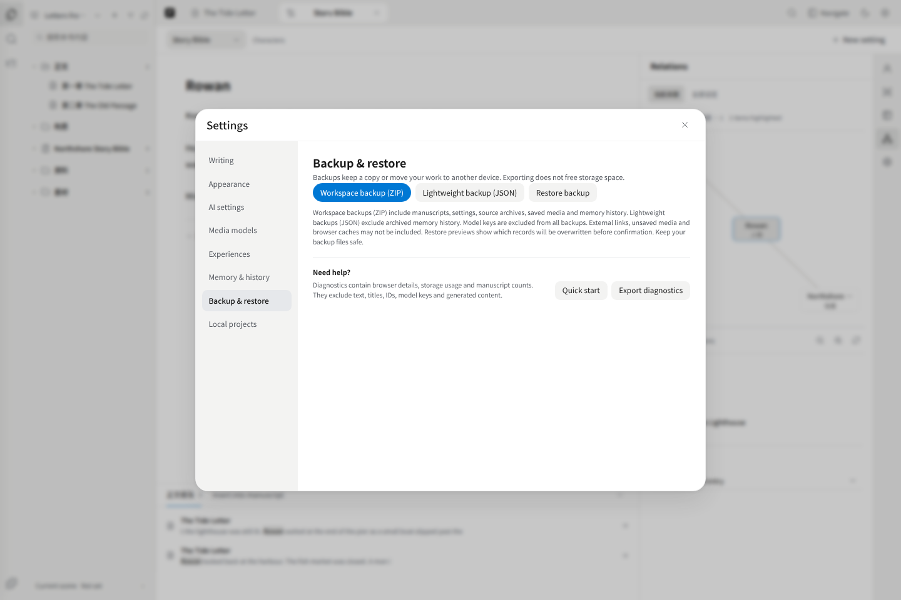

# Settings, AI and backups

## Languages and appearance

In **Appearance**, choose Interface language and Assistant language. These are device preferences and are intentionally excluded from workspace backups. Changing these preferences does not translate existing text.

Theme, zoom and writing typography remain separate. Switching languages does not translate your manuscript, reset the editor or regenerate AI results.

## AI setup and data

Writing and backups work without AI. In **Settings → Models**, switch between Text, Images and Video to manage configurations. A built-in model is available only if the deployment server provides its key. On local/self-hosted deployments with model editing enabled, you can add a supported text configuration. The assistant’s model picker switches saved configurations and links to Manage models. Each send or regeneration captures the current model and permissions; changing either affects the next request, without changing running tasks or the runtime’s global default. Delegated prose generation keeps the same captured model. Public visitors cannot change the server model. Image and video pickers use the same configuration lists as their respective tabs in Models.

When you invoke AI, the requested selection and relevant context or linked references may be sent through the deployment server to the configured provider. Do not send material you are not authorized to share. Model keys are excluded from backups. Provider error details may remain in their original language.

## Memory & history

The story-fact ledger is different from manuscript version history. Pinax uses Utopia’s temporal fact-ledger design as a foundation and implements facts, evidence, decisions and revisions in browser-local Dexie/IndexedDB, with some temporal coordination algorithms ported into Pinax. It does not connect to an external Utopia service and is not a full replica of Utopia’s cognitive/temporal engine. Some conflict handling still requires review, and not every data domain lives in this database. AI-extracted proposals are not automatically accepted facts. Use **Memory & history** for story facts and their evidence; use **Comments → Versions** or the chapter menu’s **Version history** to inspect manuscript versions.

## Local projects

Local deployments can bind project directories for document reading, worldbook file storage and knowledge retrieval. Public deployments disable these interfaces. Binding a directory is not an automatic migration of all browser data; knowledge retrieval additionally needs the knowledge runtime.

## Export and backup are different

**Export chapter / Export manuscript** produces readable UTF-8 Markdown. It is not a complete workspace backup.

**Workspace backup (ZIP)** includes manuscripts, settings, source archives, saved media and memory history. **Lightweight backup (JSON)** preserves local records but excludes archived memory history and media files kept outside those records. External links and unsaved media are not guaranteed to be included in either format.

## Restore

Choose **Restore backup**, then select a JSON or ZIP file. Inspect the preview: added records, overwritten records, skipped identical records, missing files and unsupported records. Confirm only when the selection is correct. Replacing newer records requires an additional checkbox. Keep the original backup file.

A failed or incomplete restore is not success. Keep the page open, preserve another backup if possible and retry using the displayed guidance. Do not clear site data to fix saving problems. ZIP restore reloads the app after successful persistence.

Browser storage belongs to the application origin. Another hostname, protocol or port can look empty even on the same device. Transfer a backup deliberately; there is no automatic cross-domain or cross-device synchronization.
